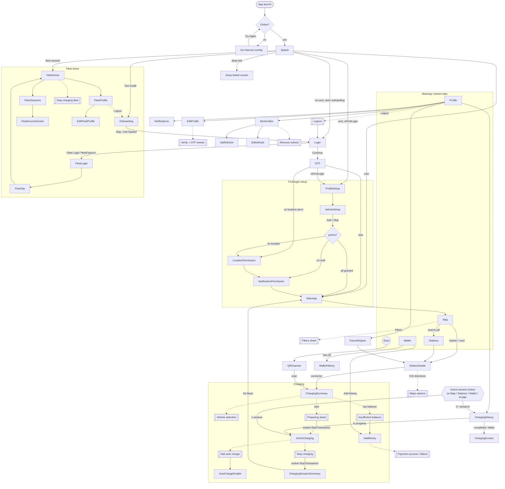

# Cruze EV: Full UI Screen Audit

> **Scope:** every user-facing screen, tab, modal, bottom sheet, dialog and global overlay in the React Native app (`src/`), plus unreachable and stub screens.
> **Type:** read-only analysis. No code was changed.
> **Snapshot:** `main` @ `eda90b1` · audited 2026-11-12.
> **Theme reference:** [src/theme/main-colors.ts](../src/theme/main-colors.ts) (colours), [fontSizes.ts](../src/theme/fontSizes.ts), [fonts.ts](../src/theme/fonts.ts) (Inter), [radius.ts](../src/theme/radius.ts), [spacing.ts](../src/theme/spacing.ts), [touch.ts](../src/theme/touch.ts).

**How to read each screen entry:** every screen uses the same nine headings: (1) Purpose, (2) Entry / exit, (3) Layout, (4) Elements with exact copy, (5) Interactions, (6) States, (7) Data, (8) Styling, (9) UX problems. Quoted strings are copied verbatim from source.

**At a glance:**

| | Count |
|---|---|
| Routed screens (root stack) | 32 |
| Bottom tabs | 5 (Map, Stations, Scanner, Wallet, Profile) |
| Modals, sheets and dialogs in use | 17 |
| Global overlays (No Internet, Update, Permission, Toast) | 4 |
| Unregistered or stub screens | 5 (+1 missing file) |
| Unused navigators | 3 |
| Unused modals / components | 3 / ~20 |

---

## 1. Overview

### 1.1 App architecture

- **One root native stack** ([AppNavigator.tsx](../src/navigations/AppNavigator.tsx)) holds every screen, with all headers hidden (`headerShown: false`). Auth, onboarding, main app, charging, wallet, profile and fleet routes are all siblings in this one stack.
- `MainApp` is a **bottom tab navigator** ([AppStack.tsx](../src/navigations/AppStack.tsx)) with 5 icon-only tabs. The centre "Scanner" tab is a raised button that pushes the root `QRScanner` route.
- **No Internet** isn't a route. When NetInfo reports offline, `AppNavigator` returns `NoInternetScreen` *instead of* the whole navigator.
- **Global overlays** mounted at the root: `AppUpdateChecker` → `UpdateAppModal`, and `PermissionModal` (never actually shown; see §8.1).
- **Providers:** `AuthProvider` (consumer user, client config, socket, running sessions) → `FleetAuthProvider` → `LocationProvider` → `WalletProvider`.
- **Client config** (`/client/info`) toggles UI: `loginType` (phone or email), `fleetFeature` (shows Fleet Login), `coupounFeature` (shows coupons), plus `termsUrl`, `privacyUrl` and `supportUrl`.

### 1.2 Navigation map

**Text summary of the main flows:**

1. **Launch:** No-Internet gate → Splash → (deep link | FleetHome | ProfileSetup | MainApp | Login | Onboarding).
2. **Consumer auth:** Onboarding → Login (phone or email) → OTP → (first login → ProfileSetup → VehicleSetup → LocationPermission → NotificationPermission → MainApp) or (LocationPermission →) MainApp.
3. **Discovery:** Map ⇄ Stations → Station Details → (directions | call | share | favourite) → Charging Summary.
4. **Charging:** (Station Details connector | QR Scanner) → Charging Summary → [Insufficient balance → Add Money] → Preparing → Active Charging → Stop → Session Summary → MainApp. Auto-charge linking branches from Active Charging.
5. **Wallet:** Wallet → Add Money (Razorpay) → success or failure; Wallet → Wallet History.
6. **Account:** Profile → Notifications | Edit Profile (+ OTP verification) | My Vehicles (→ Add / Edit / Remove) | Charging History (→ Invoice or Active Charging) | Favourite Spots (→ Station Details) | Help (external) | Logout | Delete Account (external).
7. **Fleet:** Login "Fleet Login" → Fleet Login → Fleet OTP → Fleet Home → Sessions → Invoice; Fleet Home → Profile → Edit Profile; Logout → Onboarding.

**Deep links** ([linking.ts](../src/navigations/linking.ts)): `splash`, `onboarding`, `login`, `otp`, `profile-setup`, `vehicle-setup`, `location-permission`, `notifications-permission`, `app`, `station/:stationId`, `charging/active/:sessionId`, `charging/summary`, `charging/summary/:sessionId`, `invoice/:sessionId`, `charging/history`, `scan`, `wallet/history`, `wallet/add`, `vehicles`, `vehicles/add`, `vehicles/edit/:vehicleId`, `profile/edit`, `favorites`, `notifications`, `fleet/login`, `fleet/otp`, `fleet/home`, `fleet/sessions`, `fleet/profile`, `fleet/profile/edit`, `fleet/invoice/:sessionId`, `auto-charge`. Four of these pass params the screens don't read (see §9.3).

### 1.3 All screens

**Routed screens and tabs**

| # | Screen | Route name | File | Flow | § |
|---|---|---|---|---|---|
| 1 | Splash | `Splash` | [screens/auth/SplashScreen.tsx](../src/screens/auth/SplashScreen.tsx) | Launch | 2.1 |
| 2 | Onboarding | `Onboarding` | [screens/auth/OnboardingScreen.tsx](../src/screens/auth/OnboardingScreen.tsx) | Launch | 2.2 |
| 3 | Login | `Login` | [screens/auth/LoginScreen.tsx](../src/screens/auth/LoginScreen.tsx) | Auth | 2.3 |
| 4 | OTP | `OTP` | [screens/auth/OTPScreen.tsx](../src/screens/auth/OTPScreen.tsx) | Auth | 2.4 |
| 5 | Profile Completion | `ProfileSetup` | [screens/auth/ProfileCompletionScreen.tsx](../src/screens/auth/ProfileCompletionScreen.tsx) | Setup | 2.5 |
| 6 | Vehicle Setup | `VehicleSetup` | [screens/auth/VehicleSetupScreen.tsx](../src/screens/auth/VehicleSetupScreen.tsx) | Setup | 2.6 |
| 7 | Location Permission | `LocationPermission` | [screens/auth/LocationScreen.tsx](../src/screens/auth/LocationScreen.tsx) | Setup | 2.7 |
| 8 | Enable Notifications | `NotificationPermission` | [screens/auth/EnableNotification.tsx](../src/screens/auth/EnableNotification.tsx) | Setup | 2.8 |
| 9 | No Internet | *(overlay, not a route)* | [screens/Nointernet/index.tsx](../src/screens/Nointernet/index.tsx) | Global | 2.9 |
| 10 | Bottom tab shell | `MainApp` | [navigations/AppStack.tsx](../src/navigations/AppStack.tsx) | Shell | 3.0 |
| 11 | Map | tab `Map` | [screens/map/MapViewScreen.tsx](../src/screens/map/MapViewScreen.tsx) | Discovery | 3.1 |
| 12 | Stations | tab `Stations` | [screens/stations/StationSearch.tsx](../src/screens/stations/StationSearch.tsx) | Discovery | 3.3 |
| 13 | Station Details | `StationDetails` | [screens/map/StationDetailsScreen.tsx](../src/screens/map/StationDetailsScreen.tsx) | Discovery | 3.4 |
| 14 | Charging Summary | `ChargingSummary` | [screens/stations/charger-summary/ChargingSummary.tsx](../src/screens/stations/charger-summary/ChargingSummary.tsx) | Charging | 4.1 |
| 15 | Active Charging | `ActiveCharging` | [screens/charging/ActiveChargingScreen.tsx](../src/screens/charging/ActiveChargingScreen.tsx) | Charging | 4.5 |
| 16 | Auto Charge Vehicle | `AutoChargeEnable` | [screens/charging/AutoChargeEnable.tsx](../src/screens/charging/AutoChargeEnable.tsx) | Charging | 4.8 |
| 17 | Charging Session Summary | `ChargingSessionSummary` | [screens/charging/ChargingSessionSummary.tsx](../src/screens/charging/ChargingSessionSummary.tsx) | Charging | 4.9 |
| 18 | Invoice | `ChargingInvoice` | [screens/charging/UserChargingInvoice.tsx](../src/screens/charging/UserChargingInvoice.tsx) | Charging / History | 4.10 |
| 19 | QR Scanner | `QRScanner` + tab `Scanner` | [screens/scanner/ScannerScreen.tsx](../src/screens/scanner/ScannerScreen.tsx) | Charging | 4.11 |
| 20 | Wallet | tab `Wallet` | [screens/wallet/WalletScreen.tsx](../src/screens/wallet/WalletScreen.tsx) | Wallet | 5.1 |
| 21 | Wallet History | `WalletHistory` | [screens/wallet/WalletHistory.tsx](../src/screens/wallet/WalletHistory.tsx) | Wallet | 5.2 |
| 22 | Add Money | `AddMoney` | [screens/wallet/AddMoneyScreen.tsx](../src/screens/wallet/AddMoneyScreen.tsx) | Wallet | 5.3 |
| 23 | Profile | tab `Profile` | [screens/profile/ProfileScreen.tsx](../src/screens/profile/ProfileScreen.tsx) | Account | 6.1 |
| 24 | Edit Profile | `EditProfile` | [screens/profile/EditProfileScreen.tsx](../src/screens/profile/EditProfileScreen.tsx) | Account | 6.3 |
| 25 | My Vehicles | `MyVechiles` | [screens/profile/MyVehiclesScreen.tsx](../src/screens/profile/MyVehiclesScreen.tsx) | Vehicles | 6.6 |
| 26 | Add Vehicle | `AddVehicle` | [screens/profile/AddVehicleScreen.tsx](../src/screens/profile/AddVehicleScreen.tsx) | Vehicles | 6.8 |
| 27 | Edit Vehicle | `EditVehicle` | [screens/profile/EditVehicleScreen.tsx](../src/screens/profile/EditVehicleScreen.tsx) | Vehicles | 6.9 |
| 28 | Charging History | `ChargingHistory` | [screens/profile/charging-history/charginghistory.tsx](../src/screens/profile/charging-history/charginghistory.tsx) | History | 6.10 |
| 29 | Favourite Spots | `FavoriteSpots` | [screens/profile/FavoriteSpots/index.tsx](../src/screens/profile/FavoriteSpots/index.tsx) | Account | 6.11 |
| 30 | Notifications | `Notifications` | [screens/profile/notifications/Notifications.tsx](../src/screens/profile/notifications/Notifications.tsx) | Account | 6.12 |
| 31 | Fleet Login | `FleetLogin` | [screens/fleet/auth/Login.tsx](../src/screens/fleet/auth/Login.tsx) | Fleet | 7.1 |
| 32 | Fleet OTP | `FleetOtp` | [screens/fleet/auth/OTP.tsx](../src/screens/fleet/auth/OTP.tsx) | Fleet | 7.2 |
| 33 | Fleet Home | `FleetHome` | [screens/fleet/home/HomeScreen.tsx](../src/screens/fleet/home/HomeScreen.tsx) | Fleet | 7.3 |
| 34 | Fleet Sessions | `FleetSessions` | [screens/fleet/sessions/SessionScreen.tsx](../src/screens/fleet/sessions/SessionScreen.tsx) | Fleet | 7.5 |
| 35 | Fleet Invoice | `FleetInvoiceScreen` | [screens/fleet/sessions/SessionCharginInvoice.tsx](../src/screens/fleet/sessions/SessionCharginInvoice.tsx) | Fleet | 7.6 |
| 36 | Fleet Profile | `FleetProfile` | [screens/fleet/profile/Profile.tsx](../src/screens/fleet/profile/Profile.tsx) | Fleet | 7.7 |
| 37 | Edit Fleet Profile | `EditFleetProfile` | [components/Modals/edit-profile-fleet-modal.tsx](../src/components/Modals/edit-profile-fleet-modal.tsx) | Fleet | 7.8 |

**Modals, sheets and dialogs in use**

| # | Overlay | Component | File | Used by | § |
|---|---|---|---|---|---|
| M1 | Filters | `FiltersModal` | [Modals/filters-modal.tsx](../src/components/Modals/filters-modal.tsx) | Map | 3.2 |
| M2 | Maps options | `MapsOptionsModal` | [Modals/map-options-modal.tsx](../src/components/Modals/map-options-modal.tsx) | Station Details (iOS) | 3.5 |
| M3 | Insufficient balance | `InsufficientBalanceModal` | [Modals/insufficient-balance-modal.tsx](../src/components/Modals/insufficient-balance-modal.tsx) | Charging Summary | 4.2 |
| M4 | Preparing to charge | `PreparingToChargeModal` | [Modals/preparing-charge-modal.tsx](../src/components/Modals/preparing-charge-modal.tsx) | Charging Summary | 4.3 |
| M5 | Vehicle selection | `VehicleSelectionModal` | [Modals/vehicle-select-modal.tsx](../src/components/Modals/vehicle-select-modal.tsx) | Charging Summary | 4.4 |
| M6 | Stop charging (consumer) | `StopChargingModal` | [Modals/stop-charging.tsx](../src/components/Modals/stop-charging.tsx) | Active Charging | 4.6 |
| M7 | Add auto charge | `AddAutoCharge` | [Modals/add-auto-charge.tsx](../src/components/Modals/add-auto-charge.tsx) | Active Charging | 4.7 |
| M8 | Payment success | `PaymentSuccessModal` | [Modals/payment-success-modal.tsx](../src/components/Modals/payment-success-modal.tsx) | Add Money | 5.3 |
| M9 | Payment failure | `PaymentFailureModal` | [Modals/payment-failure-modal.tsx](../src/components/Modals/payment-failure-modal.tsx) | Add Money | 5.3 |
| M10 | Logout | `LogoutModal` | [Modals/logout-modal.tsx](../src/components/Modals/logout-modal.tsx) | Profile, Fleet Profile | 6.2 |
| M11 | Verify contact | `VerifyContactModal` | [Modals/verify-profile-modal.tsx](../src/components/Modals/verify-profile-modal.tsx) | Edit Profile | 6.4 |
| M12 | OTP verify | `OtpVerifyModal` | [Modals/otp-verify-modal.tsx](../src/components/Modals/otp-verify-modal.tsx) | Edit Profile | 6.5 |
| M13 | Remove vehicle | `VehicleDeleteModal` | [Modals/delete-modal.tsx](../src/components/Modals/delete-modal.tsx) | My Vehicles | 6.7 |
| M14 | Stop charging (fleet) | `StopChargingModal` | [Modals/stop-charging-modal.tsx](../src/components/Modals/stop-charging-modal.tsx) | Fleet Home | 7.4 |
| M15 | Permission blocked | `PermissionModal` | [Modals/permission-modal.tsx](../src/components/Modals/permission-modal.tsx) | App root, Location Permission | 8.1 |
| M16 | Custom capacity | `CustomCapacityModal` | [Modals/custom-capacity-modal.tsx](../src/components/Modals/custom-capacity-modal.tsx) | Vehicle Setup / Add / Edit | 8.2 |
| M17 | Update available | `UpdateAppModal` | [Modals/Update-Modal.tsx](../src/components/Modals/Update-Modal.tsx) | Global (`AppUpdateChecker`) | 8.3 |
| — | Toasts | `CustomToast` | [Toast/index.tsx](../src/components/Toast/index.tsx) | 30+ files | 8.4 |
| — | Native alerts | `Alert.alert` | — | Delete Account (Profile); share, maps and call errors (Station Details); update store error | 6.1, 3.4 |

**Not reachable / unused:** see §9 (5 stub or unregistered screens, 1 missing file, 3 unused navigators, 3 unused modals, ~20 unused components).

---
## 2. Launch, Onboarding & Consumer Auth Flow

---

### 2.1 Splash — `Splash`

**File:** [src/screens/auth/SplashScreen.tsx](../src/screens/auth/SplashScreen.tsx) · **Flow:** Launch

1. **Purpose.** A brand moment while auth state, the fleet session and the client config load. It also decides the first real screen.
2. **Entry / exit.**
   - Entry: app cold start (`initialRouteName="Splash"`).
   - Exit (all `navigation.replace`): it waits until `loading`, `initializing` and `configLoading` are all false, then:
     - If a deep link (`Linking.getInitialURL()`) exists → **returns early and does nothing**. The linking config handles the route.
     - Fleet user present → `FleetHome`
     - Consumer user with `isFirstLogin` → `ProfileSetup`
     - Consumer user → `MainApp`
     - No user and the `first_login_key` flag is set → `Login`
     - No user and no flag → `Onboarding`
3. **Layout.** Full-bleed teal background with a centered stack: an outer glow circle (170px, white 10%), a middle glow (120px, white 15%) and an 85px white disc holding the icon.
4. **Elements.** A Lucide `Zap` icon (40px, teal, filled). There is **no text, no logo image, no app name and no version**.
5. **Interactions.** None. On mount it plays a spring scale-in (0.4→1) plus an opacity fade, and the icon pulses in a loop (1→1.12, 1.4s each way).
6. **States.** Only the loading animation. There is no timeout or error state: if config or auth hangs, the user is stuck on the splash forever.
7. **Data.** `AuthContext` (`user`, `loading`, `configLoading`), `FleetContext` (`fleetUser`, `initializing`), and AsyncStorage keys `first_login_key` and `onboardingStep` (read but unused).
8. **Styling.** All theme colors (`colors.primary`, `colors.white`, `colors.surface`, `colors.black` shadow). Sizes (170/120/85) are hardcoded. `StatusBar` is `dark-content` on a teal background.
9. **UX problems.**
   - It uses a generic lightning-bolt icon instead of the brand logo, while Login and OTP show `images.logos.logo`. The brand experience is broken at first impression.
   - No hang-protection timeout or "retry" path if `/config` fails.
   - The deep-link early `return` leaves the splash mounted underneath the deep-linked screen. Pressing back from a deep-linked screen returns to a blank, animating splash.
   - The `onboardingStep` value is read but ignored. A user who killed the app mid-setup (e.g. on VehicleSetup) is sent to `MainApp` instead of resuming.

---

### 2.2 Onboarding — `Onboarding`

**File:** [src/screens/auth/OnboardingScreen.tsx](../src/screens/auth/OnboardingScreen.tsx) · **Flow:** Launch / first run

1. **Purpose.** Introduce the three core value props on first install.
2. **Entry / exit.**
   - Entry: from Splash when there is no user and `first_login_key` is unset.
   - Exit: `Skip` or `Get Started` → `replace('Login')`.
   - Side effect: on mount it writes `first_login_key = 'completed'`, so onboarding never shows again even if the user kills the app on slide 1.
3. **Layout.** A full-screen horizontal pager (FlatList, `pagingEnabled`), then a footer containing the dots, the primary button and the Skip link.
4. **Elements (exact copy).**
   | Slide | Icon | Title | Description |
   |---|---|---|---|
   | 1 | `MapPin` | **Find Chargers** | "Discover nearby charging stations with live availability and pricing" |
   | 2 | `Zap` | **Start Charging** | "Select a charger, enter amount, and start or stop charging instantly" |
   | 3 | `CreditCard` | **Pay & Track** | "Make secure payments, track sessions, manage vehicles, and get updates" |
   - Icon treatment: a 200px `primaryLight` circle around a 120px `primary` circle with a 48px white icon.
   - Pagination dots: 8px wide, growing to 24px when active. Active dots use `primary`, inactive use `border`.
   - Primary button: "Next", or "Get Started" on the last slide.
   - Text link: "Skip" (hidden on the last slide).
5. **Interactions.** Swiping pages through the slides with parallax scale, opacity and translateY. "Next" calls `scrollToIndex(+1)`. "Skip" goes to Login.
6. **States.** An intro fade/scale on mount and the last-slide variant. There is no back affordance.
7. **Data.** All hardcoded in `SLIDES`.
8. **Styling.** Title 32 / Inter SemiBold, description 17 / Regular (17 is not in `fontSizes`). The `accentColor` branching logic is dead code because every slide uses `colors.primary`. Footer `paddingBottom: 48` is overridden inline by the safe-area inset.
9. **UX problems.**
   - Uses generic icons only, with no illustrations or product imagery. It feels like a template.
   - Primary button text is **12px** (the `PrimaryButton` default) beneath a 32px title, which is a strong hierarchy mismatch.
   - Dot color snaps on `activeIndex` instead of interpolating, so it flickers mid-swipe.
   - The dots carry no accessibility labels, and nothing announces "slide x of 3".

---

### 2.3 Login (consumer) — `Login`

**File:** [src/screens/auth/LoginScreen.tsx](../src/screens/auth/LoginScreen.tsx) · **Flow:** Auth

1. **Purpose.** Enter a phone number or email to receive an OTP.
2. **Entry / exit.**
   - Entry: from Onboarding, from Splash (returning user without a session), after logout, and from the `login` deep link.
   - Exit:
     - Continue → `POST /auth/app/login` → `navigate('OTP', { type, value })`
     - "Fleet Login" → `FleetLogin`
     - Terms / Privacy → external browser
3. **Layout (top → bottom).** Centered 180×180 logo, title, subtitle, input, an inline row (switch link on the left, fleet link on the right), Continue button, and a terms line.
4. **Elements (exact copy).**
   - Logo: `images.logos.logo`. The client-config logo is commented out.
   - Title: "Enter mobile number" / "Enter email".
   - Subtitle: "We'll send a confirmation code" (phone) / "We'll send a verification link" (email). **The email copy is wrong:** email also gets an OTP code, not a link.
   - `PhoneInput`: fixed "+91" prefix, a divider and placeholder "9876543210". It allows a maximum of 10 digits.
   - `EmailInput`: Mail icon, placeholder "name@example.com".
   - Links: "Use email instead" / "Use phone instead" (hidden when `clientConfig.loginType === 'Email'`), and "Fleet Login" (only if `clientConfig.fleetFeature === true`).
   - Button: "Continue".
   - Terms: "By continuing, you agree to our **Terms** and **Privacy**" (both links are underlined).
5. **Interactions / validation.**
   - Phone: "Mobile number is required"; regex `^\d{10}$` → "Enter valid number".
   - Email: "Email is required"; invalid format falls back to Yup's default **"email must be a valid email"** (lowercase, developer-style).
   - Continue is disabled while invalid, empty or loading.
   - API errors appear as a bottom toast (`getError`).
   - Link fallbacks: "Link not available" / "Unable to open link" toasts.
   - Tapping outside the input dismisses the keyboard.
6. **States.** Loading spinner in the button and a disabled button. Conditional UI depends on client config (`loginType`, `fleetFeature`). Errors appear only after touch.
7. **Data.** `clientConfig` from AuthContext (fetched remotely) and `POST ENDPOINTS.AUTH.LOGIN`.
8. **Styling.** Theme colors throughout. Title 22 / SemiBold, subtitle 14, links 13 (none from `fontSizes`). `letterSpacing: 0.3` on the title is hardcoded. Unused styles: `fleetButton`, `fleetText`.
9. **UX problems.**
   - The country code is hard-locked to "+91" with no picker.
   - The fleet entry point is a tiny 13px text link, easily missed, and visually equal to "Use email instead".
   - The 180px logo pushes the form down on small phones, and the CTA is not pinned to the bottom.
   - Error copy is inconsistent ("Enter valid number" vs the lowercase Yup default).
   - "Terms" / "Privacy" are separate `TouchableOpacity` elements inside a wrapping row, so line wraps break oddly and the tap targets are ~13px tall.

---

### 2.4 OTP Verification (consumer) — `OTP`

**File:** [src/screens/auth/OTPScreen.tsx](../src/screens/auth/OTPScreen.tsx) · **Flow:** Auth

1. **Purpose.** Verify the 4-digit code.
2. **Entry / exit.**
   - Entry: Login → `OTP` with `{type, value}`.
   - Exit:
     - Back chevron or "Change Number/Email" → `goBack()`
     - Success and `isFirstLogin` → `replace('ProfileSetup')`
     - Success, no location permission → `replace('LocationPermission')`
     - Otherwise → `reset(MainApp)`
3. **Layout.** Back chevron header, 180px logo, title block, 4 OTP boxes, the resend row, the Verify button, and a help line.
4. **Elements (exact copy).**
   - Title: "Enter verification code".
   - Subtitle: "We've sent a 4-digit code to" followed by the **bold value**. It falls back to "your number" / "your email".
   - Four single-digit boxes (50px tall, 12px radius).
   - Resend: "Resend in **{n}s**" (30s cooldown), which becomes the "Resend code" link.
   - Button: "Verify".
   - Help: "Didn't receive the code? **Change Number**" (or "Change Email").
   - Toasts: "Invalid OTP. Please try again." and "New OTP sent!", plus API errors.
5. **Interactions.**
   - Auto-focuses the first box after 400ms and auto-advances on each digit.
   - Backspace on an empty box moves back and clears the previous box.
   - Pasting 4 digits into box 1 fills all boxes and auto-submits.
   - Filling the last box auto-submits.
   - A failed verification clears the boxes and refocuses the first one.
6. **States.** Timer vs resend link, verify loading, resend loading (not visually indicated), and Verify disabled until complete. The filled-box state shows a teal border.
7. **Data.** Route params; `AuthContext.verifyOtp` (`POST /auth/app/verify`) and `finalizeAuth` (`GET /auth/user-by-token`, `PUT /auth/fcm`); `POST /auth/app/login` for resend; `locationService.checkPermission`.
8. **Styling.** Title 20 / Bold (Login uses 22 / SemiBold). Subtitle, timer and help text are 12–13px. The empty box border is `primaryLight` (#E6F8FA) on a white surface, which is **almost invisible**.
9. **UX problems.**
   - Empty OTP boxes have no visible boundary (very low-contrast border).
   - No `textContentType="oneTimeCode"` / `autoComplete="sms-otp"`, so there is no SMS autofill on iOS or Android.
   - The resend loading state is invisible, so users may tap repeatedly.
   - Body copy is 12–13px, too small for primary instructional text.
   - The logo block is duplicated from Login, so the visual layout jumps between the two screens (different top spacing, and a back button only on OTP).
   - The OTP inputs have no accessibility labels ("digit 1 of 4").
   - **Double toast on failure:** `AuthContext.verifyOtp` already toasts ("Invalid OTP response" or the API error), then the screen toasts "Invalid OTP. Please try again." as well.

---

### 2.5 Profile Completion — `ProfileSetup`

**File:** [src/screens/auth/ProfileCompletionScreen.tsx](../src/screens/auth/ProfileCompletionScreen.tsx) · **Flow:** First-login setup (step 1 of 4)

1. **Purpose.** Capture the user's name and terms acceptance on first login.
2. **Entry / exit.**
   - Entry: OTP (`isFirstLogin`), or Splash when the user is still marked `isFirstLogin`.
   - Exit: on success → `replace('VehicleSetup')`. If `route.params.from === 'login'` it goes to `reset(MainApp)` instead, but no caller passes that param.
   - There is no back button (the header code and its styles exist but are unused).
3. **Layout.** A 72px teal rounded-square user icon, title, subtitle, the "Full Name" field, a terms checkbox row, and a bottom action bar with Continue.
4. **Elements (exact copy).**
   - Title: "Complete your profile".
   - Subtitle: "Tell us a bit about yourself to personalize your experience".
   - Label: "Full Name", placeholder "John Doe".
   - Checkbox (18px): "I accept the **Terms & Conditions** and **Privacy Policy**" (underlined links).
   - Button: "Continue".
5. **Interactions / validation.**
   - Name rules: at least 2 characters → "Name must be at least 2 characters"; required → "Name is required".
   - Continue is disabled until there is a name and the terms are accepted.
   - Toasts: "Please accept the Terms & Conditions and Privacy Policy to continue" (unreachable while the button is disabled), "Profile updated successfully", and API errors.
   - Link taps open the URL silently, or do nothing if the config has no URL.
6. **States.** Loading on the button and the disabled button. The name is pre-filled from `user.first_name`.
7. **Data.** `AuthContext.user`, `clientConfig.termsUrl` / `privacyUrl`; `PUT /profile` with `{ first_name }`.
8. **Styling.** Mostly theme-driven. It uses a separate "label above `Input`" pattern (its own `Text` label) instead of `Input`'s `label` prop, and the label sizes differ (14 here vs 12 in `Input`). Unused: the `formData` state, the `optional`, `header` and `backBtn` styles, and the `email`/`phone` fields.
9. **UX problems.**
   - The "Full Name" value is saved as `first_name` only, so the data model doesn't match the label.
   - The 18px checkbox is a small touch target, and the label text isn't tappable to toggle it.
   - There is no progress indicator, even though this is step 1 of a 4-step setup. VehicleSetup shows "Step x of 4" for *its own* sub-steps, which is confusing.
   - The email/phone fields were removed, leaving a single-field screen with a lot of empty space.

---

### 2.6 Vehicle Setup (wizard) — `VehicleSetup`

**File:** [src/screens/auth/VehicleSetupScreen.tsx](../src/screens/auth/VehicleSetupScreen.tsx) · **Flow:** First-login setup (step 2 of 4)

1. **Purpose.** Register the user's first EV (brand → model → battery → details) in a 4-step wizard.
2. **Entry / exit.**
   - Entry: ProfileSetup → `replace('VehicleSetup')`.
   - Exit:
     - "Skip" (header) → permission check.
     - "Add Vehicle" success → toast, then the permission check.
     - The permission check routes to `LocationPermission` if location isn't granted, else `NotificationPermission` if notifications aren't granted, else `MainApp`.
     - The header back on step 1 calls `goBack()`, but the screen was reached via `replace`, so there is nothing sensible to return to.
3. **Layout.**
   - Header: back chevron, "Add Vehicle" title, "Skip" link.
   - A 6px progress bar with "Step n of 4".
   - Scroll content: a 64px car icon, the step title and subtitle, then the step body.
   - An absolute bottom bar: "Back" (secondary, from step 2 on) and "Continue" / "Add Vehicle" (primary).
   - The `CustomCapacityModal` bottom sheet.
4. **Elements (exact copy).**
   - Step titles and subtitles:
     1. "Select your brand" / "Choose your electric vehicle manufacturer"
     2. "Select your model" / "Pick your {Brand} model"
     3. "Battery capacity" / "Helps us estimate charging time accurately"
     4. "Vehicle details" / "A few more details to complete your profile"
   - Steps 1–3: a 2-column `OptionGrid` of cards (label, optional subtitle, and a check badge when selected).
   - Step 3 cards: "{capacity} kWh" with "{range} km range", plus a final card "Custom" / "Enter manually". After a custom value is saved it shows "{n} kWh".
   - Step 4 inputs:
     - "Registration Number *" (placeholder "KA01AB1234", `Hash` icon)
     - A separator: "FOR AUTO CHARGE"
     - "MAC ID" (placeholder "AA:BB:CC:DD:EE:FF", `Cpu` icon, `maxLength 12`)
     - "Max Charging Amount (₹)" (placeholder "e.g. 500")
   - Buttons: "Back", and "Continue" / "Add Vehicle" / "Adding…".
5. **Interactions / validation.**
   - Selecting a brand clears the model. Selecting a model fetches capacities. Selecting "Custom" opens the sheet.
   - Validation messages: "Registration number is required", "Invalid registration number" (under 6 characters), "Invalid MAC ID" (under 6 characters), "Must be a valid number". Custom capacity: "Minimum 10 kWh" / "Maximum 500 kWh" (the sheet itself only enforces the minimum: "Capacity is required" / "Minimum 10 kWh required").
   - Inputs are upper-cased as you type, and the amount strips non-digits.
   - Toasts: "Vehicle added successfully!", "Please enter battery capacity", and API errors.
6. **States.**
   - A large `ActivityIndicator` while brands, models or capacities load.
   - **No empty state:** if the brand or model list is empty, the step body is blank and Continue stays disabled with no explanation.
   - Continue is disabled per step until a choice is made. "Adding…" shows while submitting.
7. **Data.** `GET /vehicle/brand`, `/vehicle/model/:brandId`, `/vehicle/capacity/:modelId`; `POST /vehicle` (expects HTTP 201). Writes `VEHICLE_ADDED` to AsyncStorage.
8. **Styling.** Theme colors. Grid cards use a 14px radius and 1.5px border; the selected card gets a `primaryLight` fill and a `primaryDark` check badge. The `gridCardSub` font size is hardcoded at 11. A `StyleSheet.hairlineWidth` top border plus shadow is on the bottom bar. This screen duplicates ~80% of AddVehicle and EditVehicle.
9. **UX problems.**
   - **The MAC ID placeholder "AA:BB:CC:DD:EE:FF" is 17 characters but the input caps at 12**, so the user can't type the format shown. The field is internally named `vinNumber`, and the label "MAC ID" is jargon to consumers.
   - There are two back buttons (header chevron and footer "Back") doing the same thing.
   - Brand and model grids have no search; long brand lists are a scroll-heavy wall of identical cards with no logos.
   - "Step n of 4" conflicts with the larger onboarding sequence (Profile → Vehicle → Location → Notification).
   - The custom-capacity sheet allows over 500 kWh, but the form schema rejects it. That error only appears on step 3 because the error text isn't rendered there, so Continue is just silently disabled.

---

### 2.7 Location Permission — `LocationPermission`

**File:** [src/screens/auth/LocationScreen.tsx](../src/screens/auth/LocationScreen.tsx) · **Flow:** First-login setup (step 3 of 4) / returning login

1. **Purpose.** A pre-permission explainer before the OS location prompt.
2. **Entry / exit.**
   - Entry: from OTP (returning user without permission), VehicleSetup, or the deep link.
   - Exit: "Continue" requests the permission (and gets the location if granted), then `goToNextStep` → `replace('NotificationPermission')`. **It always advances, granted or not.**
   - If the permission is *blocked*, the `PermissionModal` shows instead.
3. **Layout.** A 64px teal rounded-square `MapPin` icon, title, subtitle, a white card with 3 feature rows, then a bottom area with the Continue button and a privacy note.
4. **Elements (exact copy).**
   - Title: "Enable Location".
   - Subtitle: "We use your location to find nearby EV charging stations and guide you there quickly."
   - Features (each a 36px teal tile with a white icon):
     - "Discover nearby charging stations" (`Navigation` icon)
     - "Turn-by-turn navigation" (`MapPin`)
     - "Check real-time availability" (`BatteryCharging`)
   - Button: "Continue".
   - Note: "Your location is never stored or shared."
   - "Skip for now" is commented out.
5. **Interactions.** Continue → OS prompt → advance. The button guards against double taps.
6. **States.** Button loading. The blocked-permission modal (see Modals). Errors are only logged to the console.
7. **Data.** `locationService`, `permissions.utils`.
8. **Styling.** The title is 26 / Bold, a third different auth title size (22, 24, 26 and 32 all appear in auth). The privacy note uses `textDisabled` (#C5D6D8) on #F4FBFC, **contrast ≈ 1.4:1**, effectively unreadable.
9. **UX problems.**
   - The button says "Continue", not "Allow location", so the OS prompt appears unannounced.
   - It always advances even if denied, then the map has no location. There is no skip path and no clear consequence.
   - The privacy text is illegible.
   - The icon tiles are teal-on-teal with white glyphs, which gives little visual hierarchy compared with the notification screen's light-tile style. The two sibling permission screens look like different apps.

---

### 2.8 Enable Notifications — `NotificationPermission`

**File:** [src/screens/auth/EnableNotification.tsx](../src/screens/auth/EnableNotification.tsx) · **Flow:** First-login setup (step 4 of 4)

1. **Purpose.** A pre-permission explainer for push notifications.
2. **Entry / exit.**
   - Entry: LocationPermission (via `goToNextStep`) or VehicleSetup.
   - Exit: "Enable Notifications" (after the OS prompt, regardless of the result) or "Skip for now" → `goToNextStep`, which clears `onboardingStep` and calls `reset(MainApp)`.
3. **Layout.** An empty header (the back button is commented out), a 60px bell circle, title, subtitle, 3 bordered feature cards, a privacy note pushed to the bottom, and a bordered bottom section with the primary button and the Skip link.
4. **Elements (exact copy).**
   - Title: "Enable notifications" (sentence case; LocationPermission's title uses Title Case).
   - Subtitle: "Get real-time updates and never miss important alerts".
   - Cards (light-teal icon tile, title, description, and a **teal circle with a `ChevronRight`**):
     - "Charging Alerts" — "Real-time charging status updates"
     - "Maintenance Updates" — "Get notified about station downtime and maintenance alerts"
     - "Exclusive Offers" — "Special deals and discounts"
   - Note: "You can manage preferences in Settings anytime".
   - Button: "Enable Notifications". While loading it shows "Please wait..." (plus a spinner, so the label is hidden anyway).
   - Link: "Skip for now".
5. **Interactions.** The button requests permission and then advances. The feature cards are **not tappable**, despite chevrons that suggest they are.
6. **States.** Loading and disabled.
7. **Data.** Hardcoded copy; `requestNotification()`.
8. **Styling.** Surface background (white), whereas every other auth screen uses `background` (#F4FBFC). The `checkmark` style name renders a ChevronRight, so the visual and semantic meanings are mixed up. The `Check`, `Power` and `ChevronLeft` imports are unused.
9. **UX problems.**
   - The chevron "affordance" on non-interactive cards is misleading. It should be a check or nothing.
   - The background color differs from the rest of onboarding.
   - The empty header wastes 56px.
   - The `Bell` icon is reused for both the hero and the first feature.

---

### 2.9 No Internet (global overlay) — not a route

**File:** [src/screens/Nointernet/index.tsx](../src/screens/Nointernet/index.tsx) · **Flow:** Global / system

1. **Purpose.** Replaces the **entire navigator** when NetInfo reports `isConnected === false`.
2. **Entry / exit.**
   - Entry: rendered by `AppNavigator` instead of the `Stack.Navigator`.
   - Exit: "Try Again" → `NetInfo.fetch()`. If connected, the parent's `retry` count increments and the navigator re-mounts.
   - **Navigation state is lost**: the stack restarts at Splash.
3. **Layout.** A centered column: an icon with a red badge, the title, the body, an optional error pill, and a full-width button.
4. **Elements (exact copy).**
   - Icon: `WifiOff` (28px, teal) in an 84px light-teal circle with a red status dot badge.
   - Title: "No Connection".
   - Body: "You're offline. Check your Wi-Fi or mobile data and try again."
   - Error pill (after a failed retry): "Still offline — check your settings".
   - Button: `RefreshCw` icon with "Try Again".
5. **Interactions.** Retry, with a spinner while checking.
6. **States.** Idle, checking (button at 65% opacity with a spinner), and still offline (red pill).
7. **Data.** NetInfo.
8. **Styling.** Theme colors. It uses a **custom inline button** (48h, 12r, 15px text) instead of `PrimaryButton` (12px text), so the button style here differs from the rest of the app. Good accessibility props (`accessibilityRole`, `accessibilityState`).
9. **UX problems.**
   - Unmounting the whole navigator destroys in-progress flows, including an **active charging session screen** and forms.
   - A non-blocking offline banner would be far less disruptive.
   - There is no auto-retry when connectivity returns. The user must tap.
## 3. Main App Shell & Discovery Flow

---

### 3.0 Bottom Tab Bar (`MainApp` → `AppStack`)

**File:** [src/navigations/AppStack.tsx](../src/navigations/AppStack.tsx) · **Flow:** Main shell

1. **Purpose.** Primary navigation across the 5 main areas.
2. **Entry / exit.**
   - Entry: `reset/replace('MainApp')` after auth or setup.
   - Tabs: `Map` → MapViewScreen, `Stations` → StationSearch, `Scanner` (centre), `Wallet` → WalletScreen, `Profile` → ProfileScreen.
   - The centre Scanner button's `onPress` is overridden to `navigate('QRScanner')`, the root-stack copy of the scanner, so the `Scanner` tab screen itself is effectively never focused through the tab.
3. **Layout.** An absolute-positioned white bar (height 46 + inset on iOS, 65 + inset on Android) with a raised 62px circular teal scan button floating 24px above it.
4. **Elements.**
   - Icons only: `Map`, `EvCharger`, `ScanLine` (white on teal), `Wallet`, `User`. **No text labels** (`tabBarShowLabel: false`).
   - Active tab: teal icon, stroke 2.5, inside a 40px pill with `primary + '14'` tint. Inactive: `textTertiary`.
5. **Interactions.** Tap to switch tabs (animation `shift`). The scan button opens the full-screen scanner. The bar hides when the keyboard is open.
6. **States.** Active / inactive. The scan button scales to 1.05 when "focused".
7. **Data.** None.
8. **Styling.** Theme colors. `borderTopColor: colors.surface` (white on white) makes the top border invisible. The bar is `position: 'absolute'`, so every tab screen must pad its own bottom: Stations uses `insets.bottom + 140`, Map positions things at `insets.bottom + 80`, `+120` or `+270`.
9. **UX problems.**
   - **There are no labels.** `EvCharger` vs `Map` vs `Wallet` icons are ambiguous for first-time users, and screen readers get no tab names: no `tabBarAccessibilityLabel` is set.
   - The tab bar has no top separator or shadow, so it blends into white content.
   - The bottom padding offsets are hand-tuned per screen.

---

### 3.1 Map (home) — tab `Map`

**File:** [src/screens/map/MapViewScreen.tsx](../src/screens/map/MapViewScreen.tsx) · **Flow:** Discovery

1. **Purpose.** See charging stations on a map, browse nearby stations, and jump to details. This is the app's home screen.
2. **Entry / exit.**
   - Entry: the default tab after login.
   - Exit:
     - Search bar → `navigate('Stations', { fromMap: true })`, which auto-focuses the search there.
     - Tapping a marker or a station card → `StationDetails { stationId }`.
     - "View all stations" card → `Stations` tab.
     - Active-charging pulse button → `ActiveCharging { sessionId }` if there is exactly one session, else `ChargingHistory { defaultFilter: 'in_progress' }`.
     - Filter button → `FiltersModal`.
3. **Layout (z-order).**
   - A full-screen Google map (custom style `mapsJson`, clustered markers in teal).
   - A floating `SearchHeader` at the top: search pill and filter button.
   - A right-side floating column: the green `ActiveButton` (only during an active session) above the teal location FAB.
   - A bottom horizontal carousel of `StationCard`s (90% width, snapping) ending with a "View all stations" card.
   - The tab bar.
4. **Elements (exact copy).**
   - Search pill: `Search` icon and placeholder "Search stations" (teal icon, tertiary text). Accessibility label "Search stations".
   - Filter button: `SlidersHorizontal` in a 48px white square, accessibility label "Filters".
   - Markers: custom SVG pin (`Marker2.js`) coloured by `stationStatus`:
     - available → green `#22C55E`
     - upcoming → amber `#F59E0B`
     - under maintenance → yellow `#FACC15`
     - unavailable → red `#D32F2F`
     - other → grey
   - Location FAB: 44px teal circle with a `Navigation` icon (spinner while locating). Accessibility label "Go to my location".
   - Active button: 48px green circle, filled `Zap`, two expanding pulse rings. Accessibility label "Active charging session".
   - **StationCard** (per nearby station):
     - Name (14 / Bold)
     - Meta row: `MapPin` "{distance} km" · `Clock` "{ETA}"
     - Chevron tile
     - Status pill: "{n} Available" (green) or "Unavailable" (red on grey)
     - Price pill: "₹{price}/kWh"
     - Power chip: `Zap` "{power} kW"
     - Up to 2 connector chips (10px text)
     - Address (11px, 1 line)
   - "View all stations" card: `ArrowRight` in a light-teal circle with "View all stations".
5. **Interactions.**
   - Swiping the carousel animates the map to that station and selects it.
   - Tapping a marker **navigates straight to Station Details**. There is no preview or selected-pin state first.
   - The FAB re-centres on the user (zoom 16) and asks for permission if needed.
   - Applying filters re-fetches the markers and nearby list and shows the toast "Filters Applied Successfully!".
   - Clearing filters resets them and re-fetches.
   - On focus it calls `runningSession()` to refresh the active-session state.
6. **States.**
   - Initial loading is shown only as the FAB spinner. The map shows the default region (Hyderabad, hardcoded `17.4239, 78.3772`) until a location arrives.
   - **No nearby stations:** the carousel is hidden and the FABs drop lower. There is no empty message.
   - **API error:** only logged to the console, so the user sees an empty map.
   - **Location denied:** stays on the default region with no explanation.
   - The active-session button appears only when `user && session.length > 0`.
7. **Data.**
   - `StationsAPI.allStations(filters)` → `/station/locations` for markers.
   - `StationsAPI.getNearby({lat,lng,limit:5,page:1})` → `/station` for the carousel.
   - `AuthContext.session` for the active session; `locationService`.
   - `searchQuery` is local state but is **never used to filter**. The pill only navigates away.
8. **Styling.**
   - Hardcoded marker hexes `#F59E0B` and `#FACC15`, which duplicate `colors.warning` and `connectorReserved` without using them.
   - `viewAllText` uses `fontWeight: "600"` with no Inter family, so it falls back to the system font.
   - The `SearchHeader` top offset is hardcoded (`55` on iOS, `StatusBar.currentHeight + 8` on Android) instead of using safe-area insets.
   - Card radius is 16 while the View-all card is 18.
9. **UX problems.**
   - **Hardcoded fallback location** (Hyderabad) shows a random city to users elsewhere.
   - A marker tap jumps straight to a full screen. Modern map UX highlights the pin and shows a peek card first; a `StationDetailsModal` for exactly this exists but is commented out.
   - The search "input" is a fake button that switches tabs, which is surprising, and it loses map context.
   - Filter state isn't reflected anywhere: no badge or count on the filter button. Re-opening filters shows the defaults rather than the applied values, because `initialValues` isn't passed.
   - The carousel limit is 5 stations with no clear "nearby" heading.
   - The active-session indicator here is a **green circle**, while Stations, Wallet and Profile use a **teal rounded square** for the same thing.
   - The ETA is derived from distance only (`formatEta`), and the card text is very small (10–12px).
   - There are no loading, empty or error states for the station data.

---

### 3.2 Filters (bottom sheet) — `FiltersModal`

**File:** [src/components/Modals/filters-modal.tsx](../src/components/Modals/filters-modal.tsx) · **Flow:** Discovery · **Used by:** Map

1. **Purpose.** Narrow the map stations by power, access type and connector.
2. **Entry / exit.** Opened from the Map filter button. Closed by the `X`, Android back, "Apply Filters" or "Clear". Tapping the backdrop does **not** close it (there's no backdrop press handler).
3. **Layout.** A slide-up sheet (60–95% of the screen height, 28px top radius): header, Min Power slider, Accessibility toggle, a horizontal Connectors carousel, then the action row.
4. **Elements (exact copy).**
   - Title "Filters" with a close `X` (accessibility label "Close filters").
   - "Min. Power" with a live value "{n} kW". Slider range 1–350, step 5, default 7. Custom 28px white thumb with a teal ring.
   - "Accessibility": two pill toggles, "Public" and "Private" (default **Public**).
   - "Connectors": 78×86 cards, each with a connector SVG icon and the `portType` label (10px), multi-select.
   - Buttons: "Clear" (secondary) and "Apply Filters" (primary).
5. **Interactions.** Slider drag, toggle select (single), connector multi-select toggle. Apply shows the toast "Filters Applied Successfully!". Clear resets and calls `onClear`.
6. **States.** Selected toggle and card: teal border with a `primaryLight` fill. There is no "n filters active" state.
7. **Data.** Connector list from `CONNECTOR_CONFIGS` (local constants).
8. **Styling.** Title 17px (not in the scale). Backdrop `withAlpha(colors.black, 0.45)`. Uses `PrimaryButton` (12px text) next to `SecondaryButton` (14px text) **side by side**, so the font-size mismatch is directly visible. The slider uses a hardcoded `width - 40`.
9. **UX problems.**
   - The "Public" default plus a 7 kW minimum means even "no filter" silently filters.
   - The slider step of 5 starting at 1 gives odd values (1, 6, 11 … 346), never round numbers like 50 or 150.
   - The connector carousel hides options off-screen, and the 10px labels are hard to read.
   - There's no backdrop dismiss and no drag handle, which is inconsistent with the other sheets (CustomCapacity, MapsOptions) that have both.
   - The success toast is redundant, since the map visibly updates.

---

### 3.3 Stations (list & search) — tab `Stations`

**File:** [src/screens/stations/StationSearch.tsx](../src/screens/stations/StationSearch.tsx) · **Flow:** Discovery

1. **Purpose.** A searchable, paginated list of nearby stations with favourite toggles.
2. **Entry / exit.**
   - Entry: the Stations tab, the Map search pill (auto-focuses the input) or the Map "View all".
   - Exit:
     - Card → `StationDetails`.
     - Profile icon → `Profile` tab.
     - Active-charging FAB → `ActiveCharging` or `ChargingHistory`.
3. **Layout.** `ScreenHeader` (title and profile button), the search input, the station list (pull-to-refresh, infinite scroll), and a floating active-charging FAB.
4. **Elements (exact copy).**
   - Header title **"Stations"** (22 / Bold / **teal**) with a 38px teal-tint `User` button (accessibility label "Profile").
   - Search: `Search` icon, placeholder "Search stations...".
   - **FavouriteStationCard** (per station):
     - A `MapPin` tile, name (14 / SemiBold), address (12px)
     - A heart toggle (red-filled when favourited, teal outline otherwise)
     - A divider, then pills: "{available}/{connectors} Free" (or "Unavailable" in red), `Zap` "{n} kW", and `Navigation` "{d} km" right-aligned
   - Empty states (`EmptyView`):
     - Location denied: `MapPinOff` icon, "Location is off" / "Turn on location to see charging stations near you." / button **"Enable location"**
     - No results with a search term: `SearchX` icon, "No stations found" / "Try searching with a different keyword." / button **"Clear Search"**
     - No stations: "No stations available" / "Stations will appear here once available."
   - Toasts: "Added to favourites ❤️", "Removed from favourites", "Something went wrong. Please try again."
5. **Interactions.**
   - Search is debounced by 500ms.
   - Pull to refresh. Infinite scroll at a 40% threshold, 5 items per page.
   - The heart toggles optimistically and rolls back on error.
   - On focus it re-syncs favourites so changes made on Details or Favourite Spots show here.
   - Dragging the list dismisses the keyboard.
6. **States.** Three skeleton cards on first load, a footer skeleton while loading more, the refresh spinner, three empty variants, and the FAB visible during an active session.
7. **Data.** `StationsAPI.getNearby` (paginated, with `search`) plus `StationsAPI.getFavourites({limit:100})` in parallel; location service; `AuthContext.session`.
8. **Styling.** Theme colors. The page title is **teal**, whereas every other page title (`Gobackheader`) is dark. `ScreenHeader` uses `colors.primary + 20`, which only works because the number 20 is concatenated as a hex alpha. The card radius is 18 (StationCard on the Map uses 16). The emoji "❤️" appears in a toast.
9. **UX problems.**
   - The page size of 5 is tiny, so users trigger frequent loads and see skeleton flashes.
   - There are no filters or sort options here, even though Map has filters. Two discovery surfaces have different capabilities.
   - A profile shortcut in the header duplicates the Profile tab directly below.
   - **Two different station card designs** (`StationCard` on Map vs `FavouriteStationCard` here) show the same data differently: price appears only on the map card, availability formats differ ("2 Available" vs "2/4 Free"), and the hearts differ.
   - A favourites API failure is silently swallowed, because the whole `Promise.all` fails and only gets logged.
   - API errors show the "No stations available" empty state instead of an error-and-retry state.

---

### 3.4 Station Details — `StationDetails`

**File:** [src/screens/map/StationDetailsScreen.tsx](../src/screens/map/StationDetailsScreen.tsx) · **Flow:** Discovery → Charging

1. **Purpose.** Review a station, get directions or call, and pick a connector to start charging.
2. **Entry / exit.**
   - Entry: Map marker or card, Stations card, Favourite Spots card, or the deep link `station/:stationId`.
   - Exit:
     - Back arrow → `goBack()`.
     - Share → OS share sheet.
     - Heart → toggles favourite.
     - "Get Directions" → Google Maps (Android), or `MapsOptionsModal` (iOS) → Apple or Google Maps.
     - Phone → `tel:`.
     - Connector card (Available or Preparing) → `ChargingSummary { stationId, connectorId, chargerId }`.
     - Any other connector status → toast "Connector is currently {status}".
3. **Layout (top → bottom).**
   - `DetailHeader`: back on the left; share and heart on the right.
   - Inside a pull-to-refresh scroll:
     - `HeroImage` (200px, cover)
     - `StationInfoCard`
     - `ActionBar`
     - `ChargersTab`: a tip banner, then charger sections sorted with available first
   - The `MapsOptionsModal` sheet.
4. **Elements (exact copy).**
   - Header buttons: 34px rounded squares with `ArrowLeft`, `Share2` and `Heart` (teal-filled when favourited). **No accessibility labels.**
   - Hero: the station's first media image, falling back to `images.station.image`.
   - **StationInfoCard:**
     - Name (16 / Bold, 2 lines)
     - A status pill with the raw `status` text (green for Available, red for Charging, grey otherwise)
     - `MapPin` with the address
     - Chips: `Navigation2` "{distance} km" and `Clock` "{eta} away"
     - The rating and network row is commented out
   - **ActionBar:** a primary "Get Directions" button (`Navigation2`, 12px bold) and a 44px phone button (accessibility label "Call station").
   - **ChargersTab:**
     - Tip: `Zap` "Tap a connector to check live status and start a session."
     - Section header per charger: a `PlugZap` tile, the **raw `chargerId`** as the title, "{n} connector(s)", and a badge "{free}/{total} free"
     - **ChargerCard** per connector:
       - Connector type SVG icon in a 64px zone
       - "Connector-{id} {AC|DC}"
       - Port type name ("Unknown Type" fallback)
       - `Zap` "{kW} kW" · "₹{price}/unit"
       - A status pill with the **raw OCPP status** (e.g. "SuspendedEVSE", "Faulted")
       - When DC and Charging: a battery icon with "{soc}%" and `Clock` "{time to full}"
   - Share message: "🔌 {name} 📍 {address} Open in app: **lekha://station/{id}** Or view online: **https://lekha.com/station/{id}** Navigate: {maps link}".
   - Alerts: "Error / Unable to share station details", "Unable to open Apple Maps", "Unable to open Google Maps", "Unsupported / Calling is not supported on this device", "Error / Unable to initiate phone call".
5. **Interactions.** Pull to refresh. The heart calls `toggleFavourite(id, false)` **with a hardcoded `false`** and then toasts the server message. Connector taps are gated by status. On iOS, directions open a chooser sheet.
6. **States.**
   - A full-page skeleton (`SkeletonLoader`) on first load and the refresh spinner.
   - **No error state:** if the API fails, the skeleton disappears and the page renders blank or `undefined` values.
   - **No empty state** for a station with zero chargers.
   - Favourited vs not. Connector availability styling: available connectors get a teal tint, others grey.
7. **Data.** `StationsAPI.getDetails` (`/station/:id`) mapped by `mapStationToDetails` (with hardcoded `rating: 4`, `network: 'Unknown'`, `openingHours: '24 / 7'`, `pricePerKwh: 0`); `getFavourites`; location for distance (Hyderabad fallback).
8. **Styling.** Mostly theme-driven, but the screen is very dense: 10–12px text everywhere, a 34px header button and 15px icons. The badge text in charger sections is 14px while the charger title is 12px, which inverts the hierarchy. `ChargerCard` builds a status tint via `${statusColor}20`. Dead code: `CONNECTOR_IMAGES` (Wikimedia URLs) and `ConnectorImage` are never rendered.
9. **UX problems.**
   - **Bug: the heart sends `isFavourite: false` every time**, so a station can't be *added* to favourites from this screen. Only removal works, assuming the server treats false as remove.
   - **Wrong brand in the share text:** `lekha://` and `lekha.com` (left over from a previous white-label), not Cruze EV.
   - The call button always renders even when `phone` is empty, which leads to a broken `tel:` link.
   - **The Info tab (pricing, hours, amenities, contact) is unreachable** because the `TabBar` is commented out. Amenities and hours are never shown.
   - Raw backend identifiers (`chargerId`, OCPP statuses like "SuspendedEVSE") are shown to consumers.
   - There's no sticky CTA. The user must scroll to find and tap a connector card, and the only hint is a small tip banner.
   - The heart colour differs from the list cards (teal fill here, red on lists).
   - The header icon buttons have no accessibility labels and are below the 44px minimum.
   - `charger.tariff[0].price` will crash the mapper for any charger without a tariff.

---

### 3.5 Maps Options (bottom sheet) — `MapsOptionsModal`

**File:** [src/components/Modals/map-options-modal.tsx](../src/components/Modals/map-options-modal.tsx) · **Flow:** Discovery · **Used by:** Station Details (iOS only)

1. **Purpose.** Choose a navigation app.
2. **Entry / exit.** Opened by "Get Directions" on iOS. Closed by the backdrop or by choosing an option (which opens the app).
3. **Layout.** A sheet with a drag handle, the title and two option rows.
4. **Elements.** Title "Open Directions". Rows: an Apple Maps icon image with "Apple Maps", and a Google Maps icon image with "Google Maps". **No Cancel button.**
5. **Interactions.** Tap a row to open that app's URL. Tap the backdrop to close.
6. **States.** Spring-in animation only.
7. **Data.** Local assets `images.icons.applemaps` and `googlemaps`.
8. **Styling.** Theme tokens; follows the custom-sheet pattern shared with `CustomCapacityModal`.
9. **UX problems.** There's no explicit Cancel, and the handle is not draggable. Waze and other installed apps aren't offered. The sheet doesn't check whether Google Maps is installed (the web URL works as a fallback).
## 4. Charging Flow

---

### 4.1 Charging Summary (pre-charge setup) — `ChargingSummary`

**File:** [src/screens/stations/charger-summary/ChargingSummary.tsx](../src/screens/stations/charger-summary/ChargingSummary.tsx) · **Flow:** Charging

1. **Purpose.** Choose how much to charge (by amount, by kWh or, on DC chargers, by battery %), review the estimate and price, then start the session.
2. **Entry / exit.**
   - Entry: Station Details connector tap, or the QR Scanner after a successful scan. Params: `{ stationId?, chargerId, connectorId }`. Deep link: `charging/summary`, which has no params and **crashes**, because `route.params` is destructured without a guard.
   - Exit:
     - Back arrow or the charger card's pencil → `goBack()`.
     - Header right ("Select Vehicle" / model name) → `VehicleSelectionModal`.
     - "Start Charging" with too little balance → `InsufficientBalanceModal` → "Add ₹x" → `AddMoney { amount: shortfall, source: 'charging' }`.
     - "Start Charging" success → `PreparingToChargeModal`. The socket event `StartTransaction` then triggers `navigate('ActiveCharging', { sessionId, chargerId, connectorId })`.
3. **Layout (top → bottom).**
   - `Gobackheader`: back arrow, the title "Charging Summary", and the right-side vehicle selector.
   - Scroll content:
     - `ChargerInfoCard`
     - `ConnectorMessageCard` (status banner)
     - An input card containing the tabs (Amount / kWh / Battery) and the active input section
     - `EstimateCard`
     - `PricingSummaryCard` (collapsible)
   - `StickyCTA` pinned to the bottom.
   - Three modals: Insufficient Balance, Preparing, Vehicle Selection.
4. **Elements (exact copy).**
   - Header right: a 12px `CarIcon` with "Select Vehicle", or the selected `{model.name}` once a vehicle is chosen.
   - **ChargerInfoCard:**
     - A `Zap` tile
     - `{station name}`
     - `{chargerId} (CONNECTOR-{id})`
     - Details line: `{AC|DC} · {capacity} kW · {portType} · ₹{rate}/kWh`
     - A pencil edit button (no label)
     - An optional "Recommended" badge, which is never used
   - **ConnectorMessageCard** (a `Zap` icon with a message tinted by status):
     - Available: "Connector is ready to connect" (green)
     - Charging: "Charging in progress" (teal)
     - Preparing: "Preparing connector for charging" (amber)
     - SuspendedEV: "Charging paused by vehicle"
     - Unknown: "Connector status unknown" (grey)
   - **Tabs:**
     - `IndianRupee` "Amount", `Zap` "kWh", and `BatteryCharging` "Battery" (DC only).
     - The active tab is teal and bold with a 2px underline pip.
   - **AmountInputSection:**
     - Label "Enter Amount", a ₹ prefix and placeholder "0.00" (22px value text).
     - Quick chips: "₹100", "₹200", "₹500", "₹1000".
   - **UnitsInputSection:**
     - Label "Enter Units", a `Zap` prefix, placeholder "0" and a "kWh" suffix.
     - Hint: `Info` "1 kWh ≈ ₹{rate} at this station".
     - Chips: 5, 10, 20, 30 (kWh).
   - **BatterySliderSection:**
     - "Current {start}%" on the left, a "+{increase}%" pill in the middle and "Target {end}%" on the right.
     - A dual-thumb slider (0–95, step 5) with tick labels.
     - "Quick target" chips: 50%, 60%, 75%, 80% and **100%**. The slider max is 95, so the 100% chip can't match the slider.
   - **EstimateCard:** a dot with "Estimated Charging", then three cells: `BatteryCharging` "Battery" "+x%", `Zap` "Units" "x.xxx kWh" and `IndianRupee` "Amount" "₹x.xx".
   - **PricingSummaryCard:**
     - Header: `IndianRupee` "Price Breakdown", the total and a chevron.
     - Rows: "Charging Cost", "Discount" (only if > 0), "Subtotal", "CGST ({gst/2}%)", "SGST ({gst/2}%)", **"Total to Pay"** (highlighted).
   - **StickyCTA:** a white `Zap` with "Start Charging · ₹{amount}".
5. **Interactions / validation.**
   - Amount strips non-numeric characters, allows one decimal point and has a max length of 10. Units accepts any numeric keyboard input with **no sanitisation**.
   - Quick chips set the value.
   - Switching tabs keeps each tab's own value.
   - Selecting a vehicle resets the amount, units and battery (to 20→80; the initial default is 25→80).
   - Start with ₹0 does nothing silently: the CTA is **never disabled** and has no loading state.
   - API errors appear as a toast.
   - The socket `status` event re-fetches the charger. The socket `StartTransaction` event navigates to Active Charging.
6. **States.**
   - **Initial load:** a centred large spinner on a blank page, with no header.
   - **Error loading the charger:** logged only; the page renders with `undefined` text.
   - **No vehicle:** Battery estimates use capacity 0, so "+0.0%" shows. kWh per % falls back to 1, so the Amount and kWh tabs show an inflated battery gain.
   - **DC vs AC:** the Battery tab only exists on DC chargers.
   - The connector status banner changes colour by status.
   - The breakdown is expanded by default.
7. **Data.**
   - `GET /station/charger/:id?connectorId=` for the charger, tariff and station.
   - `GET /vehicle` for vehicles (the primary one is auto-selected).
   - `user.wallet.balance` from `AuthContext`.
   - `POST /ocpp/start/:chargerId?platform=` to start.
   - Socket.io events `join`, `status` and `StartTransaction`.
   - Estimate maths is done locally in paise with GST.
8. **Styling.**
   - Uses `spacing` tokens (one of the few screens that does).
   - `StickyCTA` uses `fontWeight: '600'` / `'400'` instead of Inter families, and `fontSizes.xs - 1` (= 11).
   - Card radii vary: 12 (input card), 10 (status banner), 12 (info card).
   - The header right icon is 12px.
   - The `UnitsInputSection` default `ratePerUnit = 14` is a hardcoded magic number.
9. **UX problems.**
   - **There are five stacked cards before the CTA** (info, status, input, estimate, breakdown), and the estimate and breakdown repeat the same total. It's information-heavy for a "how much do you want to charge" decision.
   - The CTA isn't disabled for ₹0 and gives no feedback on tap. Starting has no spinner, so double taps are possible.
   - The 100% quick chip vs the 95% slider max is contradictory.
   - Vehicle selection is hidden as a tiny text link in the header. The selected vehicle (which drives the battery estimates) isn't shown in the body.
   - Raw IDs appear again (`chargerId`, "CONNECTOR-1").
   - The full-screen spinner while loading gives no context. A skeleton would help.
   - The pencil "edit" icon on the charger card just goes back, which is ambiguous.

---

### 4.2 Insufficient Balance (bottom sheet) — `InsufficientBalanceModal`

**File:** [src/components/Modals/insufficient-balance-modal.tsx](../src/components/Modals/insufficient-balance-modal.tsx) · **Used by:** Charging Summary

1. **Purpose.** Explain the shortfall and offer a top-up.
2. **Entry / exit.** Shown when the wallet balance is less than the required amount. Closed by the backdrop, Android back or "Cancel". "Add ₹x" → `AddMoney`.
3. **Layout.** A sheet with a handle, a red wallet icon with an alert badge, the title, the subtitle, a breakdown box, and an action row.
4. **Elements (exact copy).**
   - Title: "Insufficient Balance".
   - Subtitle: "Your wallet doesn't have enough funds to start this charging session."
   - Rows: "Wallet balance ₹x.xx", "Charging cost ₹x.xx", a divider, then "Amount needed **+₹x.xx**".
   - Buttons: "Cancel", and `Plus` "Add ₹{shortfall}".
5. **Interactions.** Cancel or top up.
6. **States.** Animated in and out. It returns `null` when hidden, so the close animation never plays.
7. **Data.** Props from Charging Summary.
8. **Styling.** Custom inline buttons, not `PrimaryButton` / `SecondaryButton`. Theme colors, `error` accent.
9. **UX problems.** The "+" prefix on "Amount needed" reads like a credit. The top-up adds exactly the shortfall, which leaves a ₹0 balance after the session; it should suggest rounding up. The close animation is cut off by the `return null`.

---

### 4.3 Preparing to Charge (blocking sheet) — `PreparingToChargeModal`

**File:** [src/components/Modals/preparing-charge-modal.tsx](../src/components/Modals/preparing-charge-modal.tsx) · **Used by:** Charging Summary

1. **Purpose.** Show progress between the start request and the charger's `StartTransaction` event.
2. **Entry / exit.** Shown after `/ocpp/start` returns 200. It closes **only** when the socket `StartTransaction` event fires (then the app navigates to Active Charging). There's no Cancel, no backdrop dismiss and no `onRequestClose`, so Android back does nothing.
3. **Layout.** A sheet with a handle, a pulsing `Zap` (two expanding rings), the station name and sub line, a 3-step vertical stepper, and a footer note.
4. **Elements (exact copy).**
   - "{station name}" with "{chargerId} · ₹{amount}".
   - Steps:
     1. "Connecting to charger" — "Establishing secure link…"
     2. "Verifying payment" — "Authorising session…"
     3. "Ready to charge" — "Plug in your vehicle now"
   - Footer: `Wifi` "Keep the app open during preparation".
5. **Interactions.** None.
6. **States.** Each step moves pending → active → done on a **fixed 1.4s timer**, not on real events.
7. **Data.** Props only. The step progress is fake.
8. **Styling.** Theme colors with custom rings.
9. **UX problems.**
   - **The user can be trapped forever:** if the charger never sends `StartTransaction` (cable not plugged in, charger offline), the sheet never closes. There's no timeout, retry or cancel.
   - The progress is theatrical: "Verifying payment ✓" ticks after 1.4s whether or not anything happened, which misleads users.
   - "Plug in your vehicle now" appears *after* the request, but many chargers need the cable plugged in *before* starting. This instruction belongs on the summary screen.

---

### 4.4 Vehicle Selection (bottom sheet) — `VehicleSelectionModal`

**File:** [src/components/Modals/vehicle-select-modal.tsx](../src/components/Modals/vehicle-select-modal.tsx) · **Used by:** Charging Summary

1. **Purpose.** Pick which vehicle is being charged (this drives the battery estimates).
2. **Entry / exit.** Opened from the Charging Summary header right. Closed by the backdrop, `X`, Android back or the confirm button.
3. **Layout.** A drag handle, a header ("Select Vehicle" with a count badge, and a close button), the vehicle list, and a footer button.
4. **Elements (exact copy).**
   - Title: "Select Vehicle" with a count badge "{n}".
   - Card per vehicle:
     - A `Car` tile
     - `{regNo}`, with a "PRIMARY" badge if primary
     - "{brand} · {model}"
     - Spec chips: `Zap` "{capacity} **kW**" (wrong unit; should be kWh) and "N/A" if missing; the variant chip if present
     - A radio button
   - Empty: `Car` icon, "No Vehicles Found" / "Add a vehicle to continue."
   - Footer button: "Confirm Selection", or "Apply Changes" with a check badge when the selection changed.
   - "Add New Vehicle" exists in the component but **is never shown**, because `onAddVehicle` isn't passed.
5. **Interactions.** Tapping a card or radio sets a temporary selection. Confirm applies it.
6. **States.** Selected (teal border and tint), changed vs unchanged footer label, and empty.
7. **Data.** The `vehicles` prop.
8. **Styling.** A custom confirm button (not `PrimaryButton`). Badge text is uppercase, a style not used elsewhere.
9. **UX problems.**
   - **Dead end:** with zero vehicles the user is told to "Add a vehicle to continue" but given no button to do so.
   - The capacity unit is wrong ("kW" instead of "kWh").
   - The "set primary" logic exists but has no UI.
   - Two-step selection (tap, then confirm) is unnecessary for a single-choice list.

---

### 4.5 Active Charging (live session) — `ActiveCharging`

**File:** [src/screens/charging/ActiveChargingScreen.tsx](../src/screens/charging/ActiveChargingScreen.tsx) · **Flow:** Charging

1. **Purpose.** Monitor a live session (energy, power, battery, cost, elapsed time) and stop it.
2. **Entry / exit.**
   - Entry: Preparing modal → `StartTransaction` socket event; the Map, Stations, Wallet or Profile active-session buttons when there is exactly one session; Charging History "in progress" cards; deep link `charging/active/:sessionId`.
   - Exit:
     - Back arrow → `goBack()` (the session keeps running).
     - "Stop Charging" → `StopChargingModal` → "Stop Now" → `POST /ocpp/stop`. When the `StopTransaction` socket event fires, it calls `replace('ChargingSessionSummary', { sessionId })`.
     - "Add Vehicle Auto Charge" → `AddAutoCharge` sheet.
3. **Layout (top → bottom).**
   - `Gobackheader` with the title set to the **raw `chargerId`** and a green "Charging" chip on the right.
   - Inside a pull-to-refresh scroll:
     - An SVG progress ring with a centre value
     - The elapsed timer
     - A stats grid (2 rows × 3 columns on DC; 3 + 2 cards on AC)
     - An optional stopped box
     - An optional auto-charge button
     - The Stop button
     - A helper note
     - **A decorative station photo** at the bottom
4. **Elements (exact copy).**
   - Header chip: `Wifi` "Charging". **It's always green with this label, even after the session stops.**
   - Ring: battery % on DC ("{n}%" / "Battery Level"), otherwise "{x.xxx}" / "kWh Delivered". The ring is teal on DC and green on AC; AC progress is measured against a hardcoded 20 kWh target.
   - Timer: a `Clock` icon (no colour set, so it defaults to black) with "HH:MM:SS".
   - DC stats: "Energy Consumed {x.xxx} kWh", "Initial Charge {n}%", "EV Demand {x.xx} kW", "Power Offered {x.xx} kW", "Started Time {hh:mm}", "Amount ₹{x.xx}".
   - AC stats: "Energy Consumed", "Power Offered", "EV Demand", "Started Time", "Amount".
   - Stopped box: "Session Completed ⚡" / "This charging session has been stopped successfully."
   - `PrimaryButton` "Add Vehicle Auto Charge" (only when the transaction has a `macId` and no `vehicleId`).
   - Stop button: a red `StopCircle` with "Stop Charging", or a spinner with "Stopping...".
   - Note: "Details update automatically when the charger updates. If not, pull down to refresh."
   - Loading: a spinner with "Fetching charging details...".
   - Toasts: "Stopping charging...", "Charging Stopped Successfully ⚡", and "Failed to stop charging" (or the raw `error.message`).
5. **Interactions.** Pull to refresh. The socket `meterValue` event triggers a silent refetch. The timer ticks every second. Stop goes through a confirmation sheet.
6. **States.**
   - Loading (full-page spinner).
   - Live DC vs live AC layouts.
   - Stopping (button spinner).
   - Stopped (box shown, Stop hidden).
   - Auto-charge eligible.
   - **API error:** silent, and the screen shows zeros.
7. **Data.** `GET /device-transactions/running/:sessionId`; socket events `join`, `meterValue` and `StopTransaction`; `POST /ocpp/stop/:chargerId`. The amount is computed client-side (kWh × `calcPrice` plus tax).
8. **Styling.**
   - Responsive breakpoints are hand-rolled in the file (`IS_COMPACT`, `IS_TALL` and so on); ring sizes range from 120 to 240px.
   - Font sizes go down to 9–10px on compact screens.
   - The stop button uses a red outline style unique to this screen.
   - The "live" chip uses an inline `borderRadius: 50`.
   - The decorative image is `images.station.image`, the same fallback as Station Details.
9. **UX problems.**
   - **It doesn't name the station or the vehicle.** The title is a raw charger ID, so users can't tell which session they are viewing.
   - The status chip is static ("Charging" in green even when stopped, faulted or suspended). Live status should drive it.
   - Six equal-weight stat tiles compete with each other. The most important numbers (cost so far, time remaining or target) aren't emphasised. The "EV Demand" and "Power Offered" labels are engineering jargon.
   - There's no target or limit indicator (e.g. "₹120 of ₹200", or "will stop at 80%"), though the user set one on the summary screen.
   - The random station photo at the bottom adds no information.
   - The Clock icon has no colour.
   - The Stop button sits mid-scroll, not pinned. It's hard to reach on long screens and too easy to hit while scrolling.

---

### 4.6 Stop Charging (confirm sheet) — `StopChargingModal` (`stop-charging.tsx`)

**File:** [src/components/Modals/stop-charging.tsx](../src/components/Modals/stop-charging.tsx) · **Used by:** Active Charging

1. **Purpose.** Confirm that the user wants to stop the session.
2. **Entry / exit.** Opened from "Stop Charging". "Continue Charging", the backdrop or Android back cancel. "Stop Now" confirms.
3. **Layout.** A sheet with a handle, a red `StopCircle` icon, the title, the body text and two buttons.
4. **Elements (exact copy).** Title "Stop Charging?". Body: "**{chargerId}** will end immediately." Buttons: "Continue Charging", and `Zap` "Stop Now" (red).
5. **Interactions.** Cancel or confirm.
6. **States.** Animated in and out.
7. **Data.** The `chargerId` prop.
8. **Styling.** Custom inline buttons. The destructive button uses a `Zap` icon, which is semantically odd for "stop".
9. **UX problems.** It names the raw charger ID instead of the station or vehicle, and it doesn't show the cost or energy so far before confirming. A near-duplicate fleet variant exists (`stop-charging-modal.tsx`, see §7.4).

---

### 4.7 Add Auto Charge (bottom sheet) — `AddAutoCharge`

**File:** [src/components/Modals/add-auto-charge.tsx](../src/components/Modals/add-auto-charge.tsx) · **Used by:** Active Charging

1. **Purpose.** Link the vehicle's MAC ID, detected during this session, to one of the user's vehicles so future sessions auto-start ("Auto Charge").
2. **Entry / exit.** Opened by "Add Vehicle Auto Charge". Closed by the backdrop, Android back or Cancel. "Add New Vehicle" → closes the sheet, then `navigate('AutoChargeEnable', { macId })` via the global `navigationRef`. "Confirm" calls `PUT /vehicle/:id?type=Charging`, then closes and refreshes.
3. **Layout.** A handle, a header (a `Zap` badge, title, subtitle and a count chip), a divider, the vehicle list or an empty state, a divider, then a footer with the selection summary and two buttons.
4. **Elements (exact copy).**
   - Title: "Select Vehicle". Subtitle: "Choose a vehicle to enable automatic charging on this station."
   - `CarSelectCard` per vehicle: brand (with a "Selected" pill when chosen), model, a reg-number chip, and an "Auto Charge" badge if already enabled.
   - Empty: `Car` icon, "No Vehicles Added" / "Add a vehicle to enable Auto Charge."
   - Footer: a dot with "{brand} {model}", or "No vehicle selected".
   - Buttons: "Add New Vehicle" (secondary) and "Confirm" (primary, disabled until a vehicle is selected).
   - Toasts: "Please select a vehicle", "Auto charge enabled successfully", and API errors.
5. **Interactions.** Single-select a card, then confirm.
6. **States.** Empty, selected, and confirm loading.
7. **Data.** `GET /vehicle`, fetched **on mount, not on open**, so the list goes stale. `PUT /vehicle/:id?type=Charging` with `vinNumber: macId`.
8. **Styling.** Uses `PrimaryButton` and `SecondaryButton` side by side, so the 12px vs 14px label mismatch is visible.
9. **UX problems.** The subtitle says "on this station", but Auto Charge is vehicle-wide, which is misleading. "Add New Vehicle" leads to a screen that doesn't actually add a vehicle (see §4.8). "MAC ID" and Auto Charge are never explained to the user.

---

### 4.8 Auto Charge Vehicle — `AutoChargeEnable`

**File:** [src/screens/charging/AutoChargeEnable.tsx](../src/screens/charging/AutoChargeEnable.tsx) · **Flow:** Charging / Auto Charge

1. **Purpose.** Attach a detected MAC ID to a vehicle, chosen by brand and model.
2. **Entry / exit.** Entry: the "Add New Vehicle" button in the `AddAutoCharge` sheet, or the deep link `auto-charge`. Exit: back arrow, or success → toast and `goBack()`.
3. **Layout.** `Gobackheader` "Auto Charge Vehicle", a form (2 dropdowns and 3 inputs), and a `BottomActionBar` with the primary button.
4. **Elements (exact copy).**
   - Dropdown "Brand", placeholder "Select your vehicle brand" (searchable; search placeholder "Search...", empty "No Results Found").
   - Dropdown "Model": "Select your vehicle model", or "Select a brand first" (disabled until a brand is chosen).
   - Input "MAC ID", placeholder "e.g. AA:BB:CC:DD:EE:FF".
   - Input "Registration Number", placeholder "e.g. TS09AB1234".
   - Input "Max Amount", placeholder "e.g. 500".
   - Button: **"Add Vehicle"**.
   - Toasts: "Failed to fetch vehicles", "Failed to load brands", "Failed to load models", "Vehicle data incomplete. Please re-add vehicle.", "Auto charge enabled successfully", "Something went wrong".
5. **Interactions / validation.**
   - The schema requires "Brand is required", "Model is required" and "Registration number is required". **None of these messages ever appear**, because `touched` is never passed to `Input` (the error only renders when touched and errored) and Dropdown's error only shows after submit.
   - Choosing a model auto-fills the reg number **only if the user already owns a vehicle of that model**.
   - The MAC ID input is bound to `value={macId}`, so typing changes form state but **the field never visibly changes**.
6. **States.** Dropdown loading, and submit loading. API errors on submit are **swallowed** (empty `catch`).
7. **Data.** `GET /vehicle`, `/vehicle/brand`, `/vehicle/model/:brandId`; `POST /vehicle/:vehicleId?type=Charging`. If the user picks a model they don't own, `vehicleId` is `''`, so the request goes to `/vehicle/?type=Charging`.
8. **Styling.** Standard form components. The registration placeholder uses a Telangana plate format; VehicleSetup uses a Karnataka one ("KA01AB1234").
9. **UX problems.**
   - **The screen's model is confused:** it is titled "Auto Charge Vehicle", the button says "Add Vehicle", yet it only *updates an existing* vehicle and silently fails for new ones.
   - The MAC field is read-only in practice but looks editable.
   - Validation feedback is invisible.
   - It duplicates the Add Vehicle form with fewer guard rails.

---

### 4.9 Charging Session Summary (post-charge) — `ChargingSessionSummary`

**File:** [src/screens/charging/ChargingSessionSummary.tsx](../src/screens/charging/ChargingSessionSummary.tsx) · **Flow:** Charging

1. **Purpose.** Confirm the session is complete and show the totals, with a receipt download.
2. **Entry / exit.**
   - Entry: `replace` from Active Charging after `StopTransaction`; deep link `charging/summary/:sessionId`.
   - Exit:
     - "Go Back" → `navigate('MainApp')`.
     - The header back arrow → `goBack()`, which lands on **Charging Summary** (the pre-charge screen) with stale inputs.
     - "Download Receipt" → PDF download.
     - Support phone → `tel:`.
3. **Layout.** `Gobackheader` "Charging Session Summary", a hero (check icon, title, subtitle and an amount card), a "Session Details" card, then the action buttons.
4. **Elements (exact copy).**
   - Hero: a 52px teal `CheckCircle`, "Charging Complete", "{station} · {chargerId} ({AC|DC})", then the amount card "Total Paid" "₹{x.xx}".
   - Session Details rows:
     - `Clock` "Duration" ("{h}h {m}m" / "{m}m {s}s" / "{s}s")
     - `Zap` "Energy Used" "{x.xx} kWh"
     - `Battery` "Battery" "{start}% → {end}%" (DC only)
     - **`IndianRupee` "Connector"** "{portType}" (the wrong icon for a connector)
     - `Phone` "Support", which is either a call button or "Not Available"
   - Buttons: `SecondaryButton` "Download Receipt" and `PrimaryButton` "Go Back".
   - Loading: spinner with "Fetching session details...".
   - Toasts: "Downloading invoice...", "Failed to download invoice".
5. **Interactions.** Download, call support, finish.
6. **States.** Loading, and loaded with a header and card entrance animation. **API error:** silent, and the screen shows "Station", "₹0.00" and so on. The DC-only battery row.
7. **Data.** `GET /device-transactions/running/:sessionId` (a running-session endpoint reused for a completed session); PDF from `/invoice/:id` via `downloadPdf`.
8. **Styling.** Hand-rolled small-device styles (`IS_SMALL_DEVICE`). Buttons are stacked vertically with the secondary on top.
9. **UX problems.**
   - "Go Back" actually goes **home**, and the header back goes to the pre-charge screen. Both are confusing, and the second risks accidentally re-starting a charge.
   - It says "Download Receipt" here but "Download Invoice" on the Invoice screen.
   - The secondary action sits above the primary.
   - The wrong icon on the Connector row.
   - "Charging Complete" with a teal check isn't a strong success moment. There are no energy-saved or CO₂ stats and no rating prompt.

---

### 4.10 Invoice (consumer) — `ChargingInvoice`

**File:** [src/screens/charging/UserChargingInvoice.tsx](../src/screens/charging/UserChargingInvoice.tsx) · **Flow:** Charging history

1. **Purpose.** Show the full tax invoice for a past session and download the PDF.
2. **Entry / exit.**
   - Entry: Charging History card → `ChargingInvoice { id }`. The deep link `invoice/:sessionId` passes `sessionId`, but the screen reads `id`, so **the deep link is broken**.
   - Exit: back arrow; the screen auto-closes with an error toast if the fetch fails.
3. **Layout.** `Gobackheader`, then a scroll containing: status banner, booking ID card, Session Details card, Location & Vehicle card, Billing Breakdown card, and the Download button.
4. **Elements (exact copy).**
   - Header title: **"User Invoice" while loading, "Invoice" when loaded** (the title changes visibly).
   - `InvoiceStatusBanner`: a green `CheckCircle2`, the station name, the date and time, "₹{total}" and "Total Paid" (green success styling).
   - `InvoiceBookingId`: "Booking ID" with `{transactionId}`.
   - `InvoiceSessionDetails`: a `Zap` "Session Details" header, then "Date & Time", "Charger Type", "Connector", "Price per Unit", "Total kWh Used" and "Charging Time".
   - `InvoiceLocationVehicle`: "Location & Vehicle" (or just "Location"), with "Address" and "Vehicle".
   - `InvoiceBillingBreakdown`: an `IndianRupee` "Billing Breakdown" header, then "Energy Charge", "SGST ({n}%)", "CGST ({n}%)", a divider, and "Total Amount". The Discount and Cashback rows are commented out.
   - `InvoiceDownloadButton`: "Download Invoice".
   - Toasts: "Please wait, invoice loading...", "Invoice downloaded successfully", and API errors.
5. **Interactions.** Download the PDF.
6. **States.** An `InvoiceSkeleton` while loading. On error it shows a toast and goes back. Download loading. "Location" vs "Location & Vehicle".
7. **Data.** `GET /invoice/summary/:id`; PDF `GET /invoice/:id`.
8. **Styling.** The cards share `InvoicePrimitives` (`InfoRow`, `SectionHeader`, `Divider`), which makes this one of the more consistent screens.
9. **UX problems.**
   - The loading-state title differs ("User Invoice").
   - "Booking ID" is the OCPP transaction ID, so the label is misleading (there was no booking).
   - Five separate cards for one receipt produce a long scroll. A single receipt-style layout would read better.
   - There's no share option, only download.

> **Unused duplicate:** [src/screens/charging/ChargingInvoiceScreen.tsx](../src/screens/charging/ChargingInvoiceScreen.tsx) is an older copy of this screen (it uses `utils/invoice.buildInvoice` and fleet/user context). It is not registered in any navigator. See §9.

---

### 4.11 QR Scanner — `QRScanner` (root stack) and tab `Scanner`

**File:** [src/screens/scanner/ScannerScreen.tsx](../src/screens/scanner/ScannerScreen.tsx) · **Flow:** Charging (fast start)

1. **Purpose.** Scan the QR code on a charger to jump straight to Charging Summary for that connector.
2. **Entry / exit.**
   - Entry: the raised centre tab button (→ the root `QRScanner` route) or the deep link `scan`. The same component is also mounted as the `Scanner` tab, but the tab press is intercepted.
   - Exit:
     - A successful scan → `replace('ChargingSummary', { chargerId, connectorId })`.
     - Close (X) → `goBack()`.
     - On the permission screen, "Not now" or X → `navigation.goback()`. **That's a typo (lowercase `b`), so it throws and the user cannot leave the permission screen.**
3. **Layout.**
   - **Permission phase** (full-screen, dark):
     - A header with the text wordmark and X
     - An illustration: a pulsing ring around a viewfinder or padlock **drawn from `View`s**
     - Copy, a primary button, and a "Not now" link
     - A settings path hint when access is denied
   - **Scanning phase:**
     - A full-screen camera with an 82% black mask around a square cut-out (72% of the screen width)
     - 4 glowing corner brackets and an animated laser line
     - A top bar: X, the title and a torch toggle
     - A bottom hint
4. **Elements (exact copy).**
   - Wordmark: **"cruze ev"** (lowercase text, not the logo).
   - Permission, first time:
     - Label "Camera Permission"
     - Heading "Scan QR Codes / Instantly"
     - Body: "Cruze EV uses your camera to scan QR codes in real time. No images are stored or transmitted."
     - Button "Allow Camera", link "Not now"
   - Permission, denied:
     - Label "Access Required"
     - Heading "Enable Camera / Access"
     - Body: "Camera access was previously denied. Open Settings and enable camera for Cruze EV to continue."
     - Button "Open Settings", link "Not now"
     - Hint "Settings › Cruze EV › Camera"
   - Scanner: title "QR Scanner", a torch button (`Flashlight`, teal when on, with a glow), and the hint "Align QR code within the frame".
   - **Unreachable result UI:** a result card ("QR Detected" / "Scan Error" pill, "QR Code", the raw value, a URL chip) and buttons "Scan Again" / "Open Link". The `success` and `error` phases are never set, so none of this renders.
5. **Interactions.**
   - The first code read vibrates for 400ms and navigates immediately.
   - The charger ID is parsed from `…/charger-details/{id}?…`. **The connector ID is the last character of the query string**, so only single-digit connectors work.
   - Any QR code is accepted, as is EAN-13. A non-charger code navigates with an empty `chargerId`, so Charging Summary loads blank.
   - The torch toggles.
   - Returning to the app (AppState `active`) forces the `scanning` phase, even if the permission is still denied.
6. **States.** Permission unknown, permission denied, scanning, torch on or off. The success and error phases are dead code. There's no "invalid QR" feedback.
7. **Data.** Camera only. No API call until Charging Summary.
8. **Styling.**
   - A local colour alias object `C` maps to theme colors (good).
   - The mask colour is `withAlpha(colors.black, 0.82)`.
   - Icons (X, lock, viewfinder) are hand-drawn with `View`s instead of Lucide, unlike the rest of the app.
   - This is the only dark-themed screen.
   - The custom `primaryBtn` here is not `PrimaryButton`.
9. **UX problems.**
   - **Crash or trap:** the `goback()` typo breaks "Not now" and X on the permission screen.
   - Unknown QR codes aren't validated, which leads to a broken summary page instead of "This isn't a Cruze EV charger QR".
   - There's no manual "Enter charger ID" fallback for damaged or unreadable QR codes, a standard pattern in EV apps.
   - The connector parsing only supports connectors 0–9.
   - The wordmark is plain lowercase text rather than the brand logo.
   - Hand-drawn icons and a separate visual language make it feel like a different app.
   - ~400 lines of unused result-panel code.

---

## 5. Wallet Flow

---

### 5.1 Wallet — tab `Wallet`

**File:** [src/screens/wallet/WalletScreen.tsx](../src/screens/wallet/WalletScreen.tsx) · **Flow:** Wallet

1. **Purpose.** See the balance and recent transactions, and top up.
2. **Entry / exit.**
   - Entry: the Wallet tab.
   - Exit:
     - "Add Money" → `AddMoney` (passes an `onSuccess` **function** in the route params).
     - "See All" → `WalletHistory`.
     - Active-charging FAB → `ActiveCharging` or `ChargingHistory`.
3. **Layout.** **No page header or title.** A `BalanceCard` (teal), a "Transactions" row with "See All", a transaction list (pull-to-refresh), and the floating active-charging FAB.
4. **Elements (exact copy).**
   - **BalanceCard** (teal card, radius 16):
     - "Available Balance" with an eye or eye-off toggle
     - "₹{balance}" (32px) or "₹ ••••••" when hidden
     - A dark-teal button: `PlusCircle` "Add Money"
   - Section title "Transactions" and link "See All".
   - **TransactionCard:**
     - A green `ArrowDownCircle` (credit) or red `ArrowUpCircle` (debit) tile
     - Title: "Wallet Recharge" or "Charging - {station}" (fallback "Unknown Station")
     - The date ("12 Nov 2026")
     - The amount: "+ ₹x" (green) or "- ₹x" (red)
   - Empty: `Wallet` icon, "No Transactions Yet" / "Your wallet transactions will appear here once you start using it."
5. **Interactions.** Toggle balance visibility (not persisted). Pull to refresh (refreshes the user, transactions and running session). It reloads every time the tab gains focus.
6. **States.** `WalletSkeleton` on every focus (a full skeleton each time you switch tabs), refreshing, empty, and the FAB during an active session. API errors are silent.
7. **Data.** `user.wallet.balance` (AuthContext, refreshed via `GET /auth/user-by-token`); `WalletAPI.getTransactions(10, 1)`. There's an unused hardcoded `balance` state of `1066`.
8. **Styling.**
   - The balance card uses white text on teal `#00C8D0` (contrast ≈ 2:1).
   - The "Available Balance" label is `primaryLight` on teal, which is even lower contrast.
   - The eye icon is `primaryLight`.
   - The card's "Add Money" button is custom (8px radius, 14px text), not `PrimaryButton` (12px radius, 12px text).
9. **UX problems.**
   - There is no page title, while every other tab has one (Stations) or a profile header (Profile).
   - Every charging debit is red with an "up" arrow. Spending money on charging is normal activity, so red reads as an error. Neutral styling would be better.
   - A full skeleton reloads on every tab focus, which causes flicker.
   - The balance card has poor contrast. The hide-balance eye resets on every visit.
   - Passing a function in navigation params is non-serialisable (React Navigation warns about it and it breaks state persistence and deep links).
   - The transaction list has no grouping by date and no tap-through to a detail or invoice view.

---

### 5.2 Wallet History — `WalletHistory`

**File:** [src/screens/wallet/WalletHistory.tsx](../src/screens/wallet/WalletHistory.tsx) · **Flow:** Wallet

1. **Purpose.** The full paginated transaction history with a credit/debit filter.
2. **Entry / exit.** Entry: Wallet "See All", or the deep link `wallet/history`. Exit: back.
3. **Layout.** `Gobackheader` "Wallet History", filter chips (`Tabs`), and the transaction list (pull-to-refresh, infinite scroll).
4. **Elements (exact copy).**
   - Filter chips: "All", "Credit", "Debit" (pill chips with an animated background and border).
   - The same `TransactionCard` as the Wallet tab.
   - Empty: `Wallet` icon, "No Transactions Found" / "Your wallet activity will appear here."
5. **Interactions.** Chip filter (client-side). Pull to refresh. Infinite scroll at a 50% threshold, 10 per page.
6. **States.** A six-card skeleton on the first load, a two-card footer skeleton while loading more, and empty. **Pull-to-refresh swaps the whole list for the skeleton**, because page-1 loading triggers the full-screen skeleton path.
7. **Data.** `WalletAPI.getTransactions(10, page)`.
8. **Styling.** The `RefreshControl` has no theme tint, unlike other screens. The chip radius is 18.
9. **UX problems.**
   - The filter runs **only over already-loaded pages**, so "Debit" can show "No Transactions Found" even when debits exist on later pages.
   - The skeleton flash on refresh.
   - The empty-state copy doesn't adapt to the active filter.
   - Charging and recharge rows can't be tapped for details.

---

### 5.3 Add Money — `AddMoney`

**File:** [src/screens/wallet/AddMoneyScreen.tsx](../src/screens/wallet/AddMoneyScreen.tsx) · **Flow:** Wallet / Charging top-up

1. **Purpose.** Enter a top-up amount, optionally apply a cashback coupon, and pay with Razorpay.
2. **Entry / exit.**
   - Entry: Wallet "Add Money"; the Insufficient Balance sheet with `{ amount, source: 'charging' }`; the deep link `wallet/add`.
   - Exit:
     - "Add Money" → `POST /payment` → the Razorpay checkout overlay.
     - Success → `PaymentSuccessModal` → "Continue" → `goBack()`.
     - Failure or cancel → `PaymentFailureModal` → "Try Again" or "Dismiss".
3. **Layout.** `Gobackheader` "Add Money", then a scroll with an amount card, a conditional price breakdown card, and the coupon list (only if `clientConfig.coupounFeature`). A footer `PrimaryButton`, a full-screen spinner overlay while submitting, and two result modals.
4. **Elements (exact copy).**
   - Amount card: "Enter Amount" with an `Input` (`IndianRupee` icon, placeholder "Enter amount").
   - Price Breakdown (only when a coupon is applied):
     - "Price Breakdown", then "Amount ₹x"
     - "Coupon Discount" with a badge "{CODE} · {n}% OFF", then **"+₹x"**
     - A divider, then "Total Credits ₹x"
   - "Available Coupons": a `CoupounCard` per coupon with a `TicketPercent` icon, the code, an "Eligible" (green check) or "Not Eligible" (red X) badge at 9px, the description, and an "Applied" label when selected.
   - Coupon description fallback: "Get {n}% bonus on wallet top-up".
   - Coupon empty state: `TicketPercent` icon, "No Coupons Available" / "New offers will appear here soon."
   - Footer button: "Add Money".
   - Toasts: "Minimum ₹{n} required for this coupon", "Redirecting to payment...", "Failed to load coupons".
   - **PaymentSuccessModal:** "Payment Successful!", "Your wallet has been recharged with **{amount}** credits successfully." (the amount has no ₹ sign), "Amount Added {amount}", "Transaction ID {Razorpay orderId}", and a `Wallet` "Continue" button.
   - **PaymentFailureModal:** `XCircle` "Payment Failed", "Something went wrong while processing your payment." (the default; the real Razorpay error isn't passed in), and buttons "Dismiss" and `RefreshCcw` "Try Again".
5. **Interactions / validation.**
   - Schema: "Please enter a valid amount", "Amount is required", "Amount must be greater than 0", "Minimum amount is ₹100". **These messages never display**, because `Input` needs a `touched` prop, which isn't passed. The button simply stays disabled.
   - Tapping a coupon toggles it, and ineligible coupons are blocked.
   - Pull to refresh reloads coupons.
   - A prefilled amount comes from the insufficient-balance flow.
6. **States.**
   - Coupon skeletons, the submitting overlay, a disabled button, the success and failure modals, and the coupon feature flag on or off.
   - **Payment verification failure after a Razorpay success is silent** (`console.warn` only), so the user gets no modal and no message.
   - Order-creation errors are swallowed (empty `catch`).
7. **Data.** `GET /coupon`, `POST /payment` (creates the order), Razorpay SDK, `POST /payment/verify`, `refreshUser()`. `clientConfig.coupounFeature`.
8. **Styling.** Card-based and theme-coloured. Badge text in the coupon card is 9px. The submitting overlay is a plain spinner on a translucent layer.
9. **UX problems.**
   - **No quick-amount chips** (₹100, ₹500 …), even though Charging Summary has them. Typing is the only option.
   - Invisible validation: the user doesn't know why the button is disabled (minimum ₹100).
   - The coupon wording is inconsistent: "% OFF" plus "Coupon Discount" for what is actually a *bonus credit* ("+₹x", "Total Credits").
   - A silent verification failure is a serious trust issue: money is debited but no feedback appears.
   - The success modal shows "1100 credits", with no currency and an ambiguous unit.
   - The failure modal is generic even though the actual Razorpay error description is captured (`paymentError`) and never shown.
   - Coming from Charging Summary, it returns via `goBack()` but doesn't resume the charge start.

---

## 6. Profile & Account Flow

---

### 6.1 Profile — tab `Profile`

**File:** [src/screens/profile/ProfileScreen.tsx](../src/screens/profile/ProfileScreen.tsx) · **Flow:** Account

1. **Purpose.** An account hub: identity, vehicles, history, favourites, support, logout and account deletion.
2. **Entry / exit.**
   - Entry: the Profile tab, or the profile button on the Stations header.
   - Exit:
     - Bell → `Notifications`.
     - Hero edit pencil → `EditProfile`.
     - "My Vehicles" → `MyVechiles` (the route name is misspelled).
     - "Charging History" → `ChargingHistory`.
     - "My Favourite Spots" → `FavoriteSpots`.
     - "Help & Support" → opens `clientConfig.supportUrl` externally.
     - Logout → `LogoutModal` → `reset(Login)`.
     - "Delete Account" → native Alert → **opens `https://www.meccharge.com/delete-account` in the browser**.
     - Active-charging FAB → `ActiveCharging` or `ChargingHistory`.
3. **Layout.**
   - A 200px `primaryDark` top band behind the content.
   - `ProfileHeader`: eyebrow, title and a bell button.
   - `ProfileHeroCard`: avatar initials with an "online" dot, name, email and an edit button.
   - An "Account" section card with 3 menu rows.
   - A "Support" section card with 1 row.
   - `ProfileLogout`: a Logout button, then a footer with the version and "Delete Account".
   - The floating active-charging FAB.
4. **Elements (exact copy).**
   - Header: eyebrow **"My ACCOUNT"** (mixed case), title **`{user.userId}`** (a raw user ID), and a white `Bell` button.
   - Hero card: initials avatar, the name (or "?"), the email (or "No email provided") and an `Edit2` button.
   - Account rows (`ProfileMenuItem`: icon tile, title, subtitle, chevron):
     - `Car` "My Vehicles" — "{n} registered vehicles"
     - `BarChart3` "Charging History" — "{n} sessions"
     - `Star` "My Favourite Spots" — "{n} favourites saved"
   - Support row: `HelpCircle` "Help & Support" — "FAQs, live chat, tickets".
   - `LogOut` "Logout" (red).
   - Footer: **"Meccharge v{version}"** (hardcoded) and a red "Delete Account" link.
   - Delete alert: "Delete Account" / "This will permanently delete your account and all data. This action cannot be undone." with "Cancel" and "Delete".
   - Logout toast: **"Logged Out SucessFully !!"** (typo). AuthContext also toasts "Logged out successfully", so two toasts appear.
5. **Interactions.** Each row navigates. The bell opens notifications. Logout is confirmed via a sheet. Delete account goes through an alert and then the browser.
6. **States.**
   - **While the profile loads, the subtitles read "undefined registered vehicles", "undefined sessions" and "undefined favourites saved".**
   - No loading or error state. The FAB shows during an active session.
7. **Data.** `UserAPI.getProfile()` → `/profile` (the stats) on focus; `AuthContext.user`, `clientConfig.supportUrl`; `VersionCheck.getCurrentVersion()`. `UserAPI.deleteAccount` exists but **isn't used**.
8. **Styling.**
   - A hardcoded 200px band height.
   - `StatusBar` is `dark-content` over the dark-teal band, so the status icons are invisible on Android.
   - The `ProfileStatsRow` component (with "Sessions", "kWh Used" and "Saved" stat cards) is imported but not rendered.
   - The version text is 10px.
9. **UX problems.**
   - **Wrong brand:** "Meccharge" is in the footer and the delete-account URL points to meccharge.com. The app is Cruze EV.
   - **Misleading destructive flow:** the alert says the account "will permanently delete", but tapping Delete only opens a web page, and that page belongs to another brand.
   - The header shows a raw user ID as the main title instead of the user's name.
   - "undefined" text appears during loading.
   - `Linking.openURL(undefined)` runs if `supportUrl` is missing, with no fallback.
   - The Favourites icon is a `Star`, but hearts are used everywhere else.
   - The "online" status dot on the avatar is meaningless in this context.
   - The menu is thin: there's no Payment methods, Settings, Language, Notification preferences, Terms/Privacy or About. The Language, Help Center, Report Issue and Contact Support screens exist only as empty stubs (§9).

---

### 6.2 Logout (confirm sheet) — `LogoutModal`

**File:** [src/components/Modals/logout-modal.tsx](../src/components/Modals/logout-modal.tsx) · **Used by:** Profile (via `ProfileLogout`), Fleet Profile

1. **Purpose.** Confirm the user wants to log out.
2. **Entry / exit.** Opened by the Logout button. Cancel or backdrop to dismiss; confirm to log out.
3. **Layout.** A sheet with a handle, a red `LogOut` icon, the title, the body text and two buttons.
4. **Elements.** "Logout?" / "Are you sure you want to logout from your account?" / "Cancel" and `LogOut` "Yes, Logout".
5. **Interactions.** Cancel or confirm.
6. **States.** Animated only.
7. **Data.** None.
8. **Styling.** The same custom-sheet template as the Stop, Delete and Payment sheets (handle, icon tile, two inline buttons).
9. **UX problems.** "Logout" is used as a verb (it should be "Log out"). There's no loading state while the logout API call runs.

---

### 6.3 Edit Profile — `EditProfile`

**File:** [src/screens/profile/EditProfileScreen.tsx](../src/screens/profile/EditProfileScreen.tsx) · **Flow:** Account

1. **Purpose.** Edit the name, email, phone and GST number, verifying any changed email or phone with an OTP.
2. **Entry / exit.**
   - Entry: the Profile hero card pencil, or the deep link `profile/edit`.
   - Exit: back. "Save Changes" success → toast and `goBack()`.
   - "Verify" → `VerifyContactModal` → "Send OTP" → `OtpVerifyModal`.
3. **Layout.** `Gobackheader` "Edit Profile", a scroll form with 4 `Input`s, and a bottom bar with the primary button.
4. **Elements (exact copy).**
   - "Full Name" (`User` icon), placeholder "Enter your full name".
   - "Email" (`Mail` icon), placeholder "Enter your email address". The right-side action reads "Verify" (teal) when changed, or "Verified" (green) when already verified.
   - "Phone" (`Phone` icon), placeholder "Enter 10-digit mobile number", max 10 digits, with the same Verify / Verified action.
   - "GST (Optional)" (`FileText` icon), placeholder "E.g. 22AAAAA0000A1Z5".
   - Button: "Save Changes".
   - Validation: "Full name is required", "Invalid email", "Email is required", "Invalid phone number".
   - Toasts: "OTP sent successfully", "Verified successfully", "No changes detected", "Please verify your email", "Please verify your phone", "Profile updated successfully".
5. **Interactions.**
   - Editing the email or phone resets that field's verified flag.
   - "Verify" opens the confirm sheet, then the 4-digit OTP sheet.
   - Save is disabled until something changed, the form is valid, and changed contacts are verified.
   - Tapping outside dismisses the keyboard.
6. **States.** Disabled save, verified badges, sheet loading states. **Save errors are silent**: the error toast is commented out.
7. **Data.** `AuthContext.user`; `POST /profile/send-otp`, `POST /profile/verify-otp`, `PUT /profile`.
8. **Styling.** It uses the `Input` component's `rightText` feature (the only screen that does). The bottom bar is a hand-rolled copy of `BottomActionBar` even though that component is imported elsewhere.
9. **UX problems.**
   - **Bug:** "Full Name" is built from `first_name + last_name`, but saving writes the whole string to `first_name`. Each edit risks a duplicated surname (e.g. "John Doe" becomes first "John Doe" plus last "Doe").
   - **Email is required.** Users who signed up by phone must add *and verify* an email before saving *any* change (even their name).
   - GST has no format validation.
   - No avatar or photo editing.
   - The tiny 12px "Verify" text inside the input is easy to miss. The disabled Save gives no hint that verification is the blocker.

---

### 6.4 Verify Contact (confirm sheet) — `VerifyContactModal`

**File:** [src/components/Modals/verify-profile-modal.tsx](../src/components/Modals/verify-profile-modal.tsx) · **Used by:** Edit Profile

1. **Purpose.** Confirm before sending a verification OTP.
2. **Entry / exit.** Opened by "Verify". Cancel (blocked while loading) or "Send OTP" → the OTP sheet.
3. **Layout.** A handle, an icon, the title, the body text and two buttons. Keyboard-aware.
4. **Elements.** "Verify Email" / "Verify Phone"; "We will send a 4-digit verification OTP to **{value}**"; "Cancel" and "Send OTP" (spinner while sending).
5. **Interactions.** Cancel or send.
6. **States.** Loading.
7. **Data.** Props.
8. **Styling.** The custom-sheet template.
9. **UX problems.** An extra confirmation step: tapping "Verify" could send the OTP directly.

---

### 6.5 OTP Verify (sheet) — `OtpVerifyModal`

**File:** [src/components/Modals/otp-verify-modal.tsx](../src/components/Modals/otp-verify-modal.tsx) · **Used by:** Edit Profile

1. **Purpose.** Enter the 4-digit code for a changed email or phone.
2. **Entry / exit.** Opened after "Send OTP". Closed by the backdrop or a successful verify.
3. **Layout.** A sheet with the title, subtitle, 4 display boxes over a hidden `TextInput`, and the Verify button.
4. **Elements.** "Verify OTP"; "Enter the code sent to your email" / "…your phone"; 4 boxes; "Verify".
5. **Interactions.** Tapping the boxes focuses the hidden input. Verify becomes enabled at 4 digits.
6. **States.** Disabled until complete, then loading.
7. **Data.** Props.
8. **Styling.** The OTP box style differs from the full-screen OTP screen (§2.4), so the two OTP UIs are inconsistent.
9. **UX problems.** **No resend option and no timer.** If the code doesn't arrive, the user must cancel and restart. No SMS autofill.

---

### 6.6 My Vehicles — `MyVechiles`

**File:** [src/screens/profile/MyVehiclesScreen.tsx](../src/screens/profile/MyVehiclesScreen.tsx) · **Flow:** Vehicles

1. **Purpose.** List vehicles; toggle auto-charge; set the primary vehicle; edit, delete or add vehicles.
2. **Entry / exit.**
   - Entry: Profile "My Vehicles", or the deep link `vehicles`.
   - Exit:
     - Swipe-revealed "Edit" → `EditVehicle { vehicle }`.
     - "Add Vehicle" FAB or empty-state button → `AddVehicle`.
     - Swipe-revealed "Delete" → `VehicleDeleteModal`.
3. **Layout.** `Gobackheader` "My Vehicles", a list header (count and hint), swipeable vehicle cards (pull-to-refresh), a floating "Add Vehicle" pill FAB, and the delete sheet.
4. **Elements (exact copy).**
   - List header: "{n} Vehicle(s)" with the hint "Swipe left to edit or delete".
   - **VehicleCard:**
     - A `Car` placeholder tile
     - `{regNo}` as the title, with a ★ "Primary" badge if primary
     - The model line
     - A native `Switch` labelled "Auto-charge on" / "Auto-charge off" (9px `Zap`)
     - Pills: `Zap` "{range} km", "{capacity}", and **`{regNo}` again** as a plate pill
     - Swipe tray (140–210px): "Edit", ★ "Primary" (hidden if already primary), "Delete"
   - The first card nudges itself to hint at swiping on each focus.
   - FAB: `Plus` "Add Vehicle".
   - Empty: `Car` icon, "No vehicles yet" / "Add your EV to start managing your charging sessions." / "Add Vehicle".
   - Error: `Car` icon, "Couldn't load vehicles" / {error} / "Retry".
   - Toasts: "Vehicle removed successfully", "Auto-charge enabled" / "Auto-charge disabled", **"Primary vehicle"** (an incomplete sentence), and API errors.
5. **Interactions.** Swipe-reveal actions (PanResponder). The auto-charge switch updates optimistically and rolls back on failure. Set primary updates optimistically. Delete is confirmed, then the card collapses with an animation. Pull to refresh.
6. **States.** Three skeleton cards, an error with retry (one of the few screens with a proper error state), empty, a collapsing card, and the swipe hint.
7. **Data.** `GET /vehicle`, `PATCH /vehicle/:id` (`autoCharge`), `PATCH /vehicle/primary/:id`, `DELETE /vehicle/:id`.
8. **Styling.** Native `Switch` colours: track `primaryLight`, thumb `primary`. Pill text is 9–11px.
9. **UX problems.**
   - **Edit, Delete and Set Primary are only reachable by swiping**, which is invisible to screen-reader users and to many sighted users despite the hint. There's no tap or overflow alternative, and tapping the card does nothing (`handlePress` is a no-op).
   - The reg number is shown twice on every card.
   - The auto-charge toggle can be switched on for vehicles without a MAC ID, which may not work. There's no explanation of what auto-charge is.
   - The "Primary vehicle" toast is unfinished copy.
   - There's no vehicle image or brand logo.

---

### 6.7 Remove Vehicle (confirm sheet) — `VehicleDeleteModal`

**File:** [src/components/Modals/delete-modal.tsx](../src/components/Modals/delete-modal.tsx) · **Used by:** My Vehicles

1. **Purpose.** Confirm deleting a vehicle.
2. **Entry / exit.** Opened from the swipe "Delete". Cancel, backdrop or confirm.
3. **Layout.** The custom-sheet template.
4. **Elements.** A red `AlertTriangle`; "Remove Vehicle?"; "**{brand} {model}** ({regNo}) will be permanently removed from your account."; "Cancel" and "Yes, Remove".
5. **Interactions.** Cancel or confirm.
6. **States.** Animated only.
7. **Data.** The vehicle prop.
8. **Styling.** The custom-sheet template.
9. **UX problems.** None major. It doesn't warn when deleting the *primary* vehicle or the only vehicle.

---

### 6.8 Add Vehicle — `AddVehicle`

**File:** [src/screens/profile/AddVehicleScreen.tsx](../src/screens/profile/AddVehicleScreen.tsx) · **Flow:** Vehicles

1. **Purpose.** Add another vehicle from inside the app.
2. **Entry / exit.** Entry: My Vehicles FAB or empty state, or the deep link `vehicles/add`. Exit: back (or a step back), or success → toast "Vehicle added successfully!" and `goBack()`.
3. **Layout.** Identical to the VehicleSetup wizard (§2.6), but it uses `Gobackheader` "Add Vehicle" instead of the custom header, and has **no Skip**.
4. **Elements (exact copy).**
   - Step copy comes from `data/vehicle-data.ts` and **differs from VehicleSetup**:
     1. "Select your brand" / "Choose your EV manufacturer"
     2. "Select your model" / "Pick your {Brand} model"
     3. "Battery capacity" / "Pick the closest range option"
     4. **"Vehicle Details"** (Title Case) / "Used for automatic charging setup"
   - Fields, separator ("FOR AUTO CHARGE"), validation and buttons are the same as §2.6 ("Back", "Continue", "Add Vehicle").
5. **Interactions / validation.** Same as §2.6, including the MAC ID 12-character limit vs the 17-character placeholder.
6. **States.** Same as §2.6.
7. **Data.** Same endpoints as §2.6.
8. **Styling.** ~800 lines duplicated from VehicleSetup with small drifts (header component, copy, Title Case).
9. **UX problems.** The same problems as §2.6, plus copy drift between two screens that do the same job. The step-4 subtitle "Used for automatic charging setup" is wrong for the registration number, which is required regardless of auto-charge.

---

### 6.9 Edit Vehicle — `EditVehicle`

**File:** [src/screens/profile/EditVehicleScreen.tsx](../src/screens/profile/EditVehicleScreen.tsx) · **Flow:** Vehicles

1. **Purpose.** Modify an existing vehicle.
2. **Entry / exit.** Entry: My Vehicles swipe "Edit" with `{ vehicle }`. The deep link `vehicles/edit/:vehicleId` passes no vehicle object, so the form is empty. Exit: back, or success → toast "Vehicle updated successfully!" and `goBack()`.
3. **Layout.** The same 4-step wizard as Add, with `Gobackheader` "Edit Vehicle".
4. **Elements.** Same as Add. The final button is "Save Changes". The brand and model are pre-selected by matching names once the lists load. The reg number, MAC ID and max amount are pre-filled.
5. **Interactions.** Same wizard. **To change just the reg number, the user must click through brand → model → battery first.**
6. **States.** Same as Add.
7. **Data.** The same lookups plus `PUT /vehicle/:id`.
8. **Styling.** It duplicates Add/Setup. It also calls `useEffect` **inside the Formik render prop**, which violates the Rules of Hooks and makes the prefill fragile.
9. **UX problems.** A wizard is the wrong pattern for editing: it should be a single summary form with editable rows. Prefill depends on exact name matches, so if a brand is renamed the step looks unselected. The battery capacity prefill is incomplete (`range` starts blank).

---

### 6.10 Charging History — `ChargingHistory`

**File:** [src/screens/profile/charging-history/charginghistory.tsx](../src/screens/profile/charging-history/charginghistory.tsx) · **Flow:** History

1. **Purpose.** Past and in-progress sessions, each opening an invoice or the live session.
2. **Entry / exit.**
   - Entry: Profile row; the active-session FABs when there is more than one session (`defaultFilter: 'in_progress'`); the deep link `charging/history`.
   - Exit:
     - A completed or failed card → `ChargingInvoice { id, session }`.
     - An in-progress card → `ActiveCharging { sessionId }`.
3. **Layout.** `Gobackheader` "Charging History", filter chips, and the session list (pull-to-refresh).
4. **Elements (exact copy).**
   - Chips: "All", "Completed", "In Progress" (there is no "Failed" chip, though failed sessions exist).
   - **ChargingHistoryCard:**
     - A status badge: `CheckCircle2` "Completed" (green), `XCircle` "Failed" (red) or `Clock3` "In Progress" (amber)
     - The station name
     - `MapPin` with the location
     - The raw `sessionCode`
     - Stats: "{x} kWh", "{duration}", "CONNECTOR-{id}", and the power for in-progress sessions
     - The cost: `IndianRupee` "{x.xx}"
   - Empty: `Zap` icon, "No Charging Sessions" / "Your charging sessions will appear here."
5. **Interactions.** Chip filter (client-side, scrolls to the top). Pull to refresh. Card tap.
6. **States.** A four-card skeleton, refreshing and empty. The empty copy doesn't adapt to the filter.
7. **Data.** `GET /device-transactions`, **all at once with no pagination**, mapped by `mapTransactionToSession` from `data/mock-charging.ts` (a real mapper living in a "mock" file).
8. **Styling.** Card text is 10–14px.
9. **UX problems.**
   - Failed sessions open an **invoice**, which is confusing for a failed charge.
   - There's no pagination, so heavy users load everything.
   - Raw `sessionCode` and "CONNECTOR-n" are shown.
   - There's no monthly grouping or totals. The unused `ProfileStatsRow` would fit here.
   - The loading state's header sits under the status bar (`safeEdges` defaults to bottom), so the layout jumps when the data arrives.

---

### 6.11 Favourite Spots — `FavoriteSpots`

**File:** [src/screens/profile/FavoriteSpots/index.tsx](../src/screens/profile/FavoriteSpots/index.tsx) · **Flow:** Discovery / Account

1. **Purpose.** Saved stations with search; open or un-favourite them.
2. **Entry / exit.**
   - Entry: Profile "My Favourite Spots", or the deep link `favorites`.
   - Exit:
     - A card → `StationDetails`.
     - The empty-state "Find stations" → `MainApp > Map`.
3. **Layout.** `Gobackheader` "Favourite Spots", a search `Input`, and a paginated list (pull-to-refresh).
4. **Elements (exact copy).**
   - Search: `Search` icon, placeholder "Search stations...". It uses the generic `Input` (52px tall, radius 14), whereas the Stations tab uses `StationSearchInput` (44px, radius 12).
   - Cards: `FavouriteStationCard` with a filled red heart. Stats are hidden because the favourites endpoint lacks them.
   - Empty: `HeartOff` icon, "No favourites found" / "Try searching with a different keyword." → "Clear Search", or "You haven't added any stations yet." → "Find stations".
   - Toasts: "Removed from favourites", and API errors.
5. **Interactions.** Search is debounced. Infinite scroll. Pull to refresh. Tapping the heart removes the station **immediately** with no confirmation or undo, and it refetches on error. The list refreshes on focus.
6. **States.** Skeletons, footer skeleton, refreshing, and two empty variants.
7. **Data.** `GET /station/favourites/all` (paginated, with `search`); `POST /station/favourites/:id` with `{isFavourite:false}`.
8. **Styling.** Theme colours. The search component differs from Stations.
9. **UX problems.** Cards show no availability, power or distance, so this list is less useful than the Stations list. One mis-tap on the heart removes the station with no undo. The title says "Favourite Spots" while the Profile row says "My Favourite Spots" with a star icon.

---

### 6.12 Notifications — `Notifications`

**File:** [src/screens/profile/notifications/Notifications.tsx](../src/screens/profile/notifications/Notifications.tsx) · **Flow:** Account

1. **Purpose.** An inbox of offers, new stations, maintenance, support and information messages.
2. **Entry / exit.** Entry: the bell in the Profile header, or the deep link `notifications`. Exit: back. **Tapping a notification does nothing** (`handleNotificationPress` is a no-op).
3. **Layout.** `Gobackheader` "Notifications", horizontally scrolling filter chips, and the list (pull-to-refresh, infinite scroll).
4. **Elements (exact copy).**
   - Chips: "All", "Offers", "New Station", "Maintenance", "Customer Support", "Information".
   - **NotificationCard:** a type icon tile (`Tag` offers, `MapPin` new station, `Wrench` maintenance, `Headphones` support, `Info` information), the title (1 line), a timestamp ("12 Nov 2026, 3:04 pm" format) and the message (**clamped to 2 lines**).
   - Empty: `Bell` icon, "No Notifications" / "You're all caught up! New notifications will appear here."
5. **Interactions.** Chip filter (client-side over loaded pages). Infinite scroll. Pull to refresh.
6. **States.** A six-card skeleton (its header sits under the status bar), a footer spinner, and empty. **`isRead` is mapped but never shown**, so there's no unread styling, no badge on the bell (the dot is commented out) and no mark-as-read.
7. **Data.** `GET /notification?page=`.
8. **Styling.** Theme colours, with a per-type icon colour config.
9. **UX problems.**
   - Messages longer than 2 lines can **never be read in full**.
   - Read and unread look identical, and there's no unread badge on the Profile bell.
   - The six filter chips scroll horizontally, so the last ones are hidden.
   - Client-side filtering misses items on unloaded pages.
   - Notifications don't deep-link to the related station or session.

---

## 7. Fleet (Driver) Flow

The Fleet flow is a separate mini-app for fleet drivers. It is only reachable when `clientConfig.fleetFeature === true` (the "Fleet Login" link on the consumer Login screen). Splash skips straight to `FleetHome` when a fleet session exists. There is no tab bar. Navigation is Home → Sessions / Profile.

---

### 7.1 Fleet Login — `FleetLogin`

**File:** [src/screens/fleet/auth/Login.tsx](../src/screens/fleet/auth/Login.tsx) · **Flow:** Fleet auth

1. **Purpose.** A driver signs in with a Fleet ID and registered mobile number.
2. **Entry / exit.**
   - Entry: the "Fleet Login" link on Login, or the deep link `fleet/login`.
   - Exit:
     - Back chevron → `goBack()`.
     - "Access Fleet" → `POST /fleet/login` → toast, then `navigate('FleetOtp', { contact, fleetId, type: 'fleet', driverId })`.
     - Terms / Privacy → browser.
3. **Layout.** A decorative background accent, a header (back chevron and a "Fleet Operator" badge), the logo in a tile, the title block, a form (Fleet ID and phone), the primary button, an info card, and the terms line.
4. **Elements (exact copy).**
   - Badge: `Truck` "Fleet Operator".
   - Title: "Fleet Operator Login". Subtitle: "Enter your Fleet ID and registered mobile number".
   - `Input` "Fleet ID" (`IdCard` icon), placeholder "e.g. FLT-2024-001", auto-capitalised.
   - Label row: a `Phone` icon with "Registered Mobile", then `PhoneInput` ("+91", placeholder "9876543210").
   - Button: "Access Fleet".
   - Info card: `Zap` "Your Fleet ID was provided during onboarding. Contact support if you need help locating it."
   - Terms: "By continuing, you agree to our **Terms** and **Privacy**".
   - Validation:
     - "Fleet ID must be at least 4 characters"
     - "Fleet ID can only contain letters, numbers, and hyphens"
     - "Fleet ID is required"
     - "Enter a valid 10-digit mobile number" (must start with 6–9; the consumer Login just says "Enter valid number")
     - "Mobile number is required"
   - Toasts: "Verification code sent successfully", "Unable to open link", and API errors.
5. **Interactions.** Fleet ID is auto-focused (except on small devices). Manual scroll-to-input logic runs on keyboard show. The title hides on small devices while the keyboard is open.
6. **States.** Loading and a disabled button. A compact layout while the keyboard is visible.
7. **Data.** `FleetContext.clientConfig`; `POST /fleet/login`.
8. **Styling.**
   - Its own `normalize()` scaling helper (VehicleSetup and ActiveCharging use different ad-hoc responsive helpers).
   - Two nested `Animated.View`s with the same style (`logoSection`), which is redundant.
   - The phone field gets a separate icon-and-label row while Fleet ID uses `Input`'s built-in label, so the two fields in the same form look different.
9. **UX problems.**
   - The two inputs in one form have different label styles.
   - It uses manual keyboard scrolling hacks with fixed offsets (80, 100, 150) instead of a keyboard-aware scroll view.
   - The "Fleet Operator" badge and title talk about an "operator", but the profile calls the user a "Driver".
   - The logo is hardcoded; the client logo is commented out.

---

### 7.2 Fleet OTP — `FleetOtp`

**File:** [src/screens/fleet/auth/OTP.tsx](../src/screens/fleet/auth/OTP.tsx) · **Flow:** Fleet auth

1. **Purpose.** Verify the driver's 4-digit code.
2. **Entry / exit.** Entry: Fleet Login, or the deep link `fleet/otp`. Exit: back or "Change mobile" → `goBack()`. Success → `reset(FleetHome)`.
3. **Layout.** A header (back and a "Fleet Operator" badge), the logo, a Fleet ID chip, the title block, an OTP card (label, 4 boxes, resend row), the primary button, and a help line.
4. **Elements (exact copy).**
   - Chip: "Fleet ID: {fleetId}". **It falls back to a fake "FLT-001"** if the param is missing.
   - Title: "Verify your identity".
   - Subtitle: "A 4-digit security code was sent to **{phone}**". Masking only applies when `type === 'phone'`, but Login passes `type: 'fleet'`, so **the number is never masked**.
   - Card label: "Enter security code".
   - Timer: **"Code expires in {n}s"**, then "Resend code". The consumer flow says "Resend in", and the timer is actually the resend cooldown, not an expiry.
   - Button: "Verify & Access Fleet".
   - Help: "Wrong number? **Change mobile**".
   - Toasts: "New OTP sent successfully", "Unable to send the OTP", and API errors.
5. **Interactions.** Auto-advance and backspace, like the consumer OTP. It has `textContentType="oneTimeCode"`, so iOS autofill works here but **not** in the consumer OTP.
6. **States.** Timer vs resend, loading, disabled.
7. **Data.** `FleetContext` verify (`/fleet/verify-otp`); resend via `/fleet/login`.
8. **Styling.** Uses `verticalScale` helpers. The OTP box design differs from both the consumer OTP screen and the profile OTP sheet.
9. **UX problems.** The "Code expires" wording is inaccurate. The fake fallback Fleet ID is shown. The masking logic is dead. This is a third OTP design in the app.

---

### 7.3 Fleet Home — `FleetHome`

**File:** [src/screens/fleet/home/HomeScreen.tsx](../src/screens/fleet/home/HomeScreen.tsx) · **Flow:** Fleet

1. **Purpose.** The driver's dashboard: assigned vehicle, shift, session history link, and live charging status with a stop control.
2. **Entry / exit.**
   - Entry: the Fleet OTP reset, Splash when a fleet session exists, or the deep link `fleet/home`.
   - Exit:
     - Avatar → `FleetProfile`.
     - "Charging Sessions" card → `FleetSessions`.
     - "Stop Charging" → fleet `StopChargingModal`.
     - **Android back exits the app** (`BackHandler.exitApp()`), with no "press again to exit" confirmation.
3. **Layout.**
   - Header: a greeting, the driver name and an initial avatar.
   - Inside a pull-to-refresh scroll:
     - "ASSIGNED VEHICLE" tag with the vehicle card (or empty/loader)
     - Sessions link card
     - "CHARGING STATUS" tag with the status card (or empty/loader)
4. **Elements (exact copy).**
   - Greeting: "Good Morning" / "Good Afternoon" / "Good Evening", then `{fleetUser.name}`.
   - Section tags (uppercase, 10px icons): `Car` "ASSIGNED VEHICLE", `Zap` "CHARGING STATUS".
   - **Fleet VehicleCard:**
     - A status chip `{status}` and a reg tag `{regNo}`
     - A car image (`assets/images/car.png`, the same image for every vehicle)
     - "{brand} {model}" with **"Electric Vehicle"** (hardcoded)
     - A `Zap` chip **"65 kWh"** (hardcoded for every vehicle)
     - `Calendar` "ASSIGNED {date}" and `Clock` "SHIFT {start} – {end}"
   - Vehicle empty: `Car` icon, "No vehicle assigned" / "Contact fleet manager for vehicle assignment".
   - **SessionsLinkCard:** `BatteryCharging` "Charging Sessions" / "View all session history" with an `ArrowRight`.
   - **ChargingStatusCard:**
     - A pill "Active" / "Idle" and a `RefreshCw` button
     - "{currentLevel}%" with "Current Level"
     - Stats: `Clock` "Start Time", `Zap` "Start SOC", `Timer` "Duration"
     - A red `StopCircle` "Stop Charging" button
   - Charging empty: `BatteryCharging` icon, "No charging session" / "No charging data found for this vehicle".
   - Toasts: "No active charging session", "Stopping charging...", and API errors.
5. **Interactions.** Pull to refresh. The card's refresh icon. Stopping a charge clears the card optimistically and re-fetches after a fixed 4-second delay. Data reloads on focus.
6. **States.** Per-section small spinners, empty cards, active vs idle. Fetch errors are silent (the toasts are commented out).
7. **Data.** `GET /fleet/assigned-vehicle`, `GET /fleet/running-transaction`, `POST /fleet/ocpp/stop`, `refreshFleetUser()`.
8. **Styling.** Uppercase micro-tags (10px) not used elsewhere. Uses the `s` style object naming (other screens use `styles`).
9. **UX problems.**
   - **"Duration" renders `undefined`:** `mapChargingCard` never sets `duration`.
   - **"Current Level" reads `stopSoc ?? 0`**, so an active session usually shows **0%**.
   - Hardcoded "65 kWh" and "Electric Vehicle" for every vehicle.
   - Drivers can stop a charge but can't start one: there's no scanner or station access in the fleet flow.
   - Android back exits the app immediately with no confirmation.
   - The fixed 4-second re-fetch after stopping isn't tied to the socket event.

---

### 7.4 Stop Charging (fleet confirm sheet) — `StopChargingModal` (`stop-charging-modal.tsx`)

**File:** [src/components/Modals/stop-charging-modal.tsx](../src/components/Modals/stop-charging-modal.tsx) · **Used by:** Fleet Home

1. **Purpose.** Confirm stopping the driver's session.
2. **Entry / exit.** Opened from "Stop Charging". Cancel, backdrop or confirm.
3. **Layout.** The custom-sheet template.
4. **Elements.** A red `ZapOff`; "Stop Charging?"; "This will stop the active charging session immediately."; "Cancel" and `ZapOff` "Yes, Stop" (a spinner while stopping).
5. **Interactions.** Cancel or confirm.
6. **States.** Stopping.
7. **Data.** Props.
8. **Styling.** The custom-sheet template.
9. **UX problems.** It's a near-duplicate of the consumer `stop-charging.tsx` with different copy ("Yes, Stop" vs "Stop Now", "Cancel" vs "Continue Charging") and icons (`ZapOff` vs `StopCircle`/`Zap`). These should be one component.

---

### 7.5 Fleet Charging Sessions — `FleetSessions`

**File:** [src/screens/fleet/sessions/SessionScreen.tsx](../src/screens/fleet/sessions/SessionScreen.tsx) · **Flow:** Fleet

1. **Purpose.** The driver's session history.
2. **Entry / exit.** Entry: the Fleet Home link card, or the deep link `fleet/sessions`. Exit: back. **Any** card (including in-progress ones) → `FleetInvoiceScreen { id, session }`.
3. **Layout.** `Gobackheader` "Charging Sessions", filter chips, and the paginated list.
4. **Elements (exact copy).**
   - Chips: "All", "Completed", "In Progress".
   - The same `ChargingHistoryCard` as the consumer history (§6.10). Fallbacks: "Unknown Station", "Unknown Location".
   - Empty: "No Charging Sessions" / "Charging sessions will appear here." (slightly different wording from the consumer screen).
5. **Interactions.** Chip filter (client-side). Infinite scroll (10 per page). Pull to refresh.
6. **States.** Skeleton, a footer skeleton, empty. Errors appear as a toast.
7. **Data.** `GET /fleet/transaction?page=&limit=10`.
8. **Styling.** Shares the consumer components, which keeps it consistent.
9. **UX problems.** In-progress sessions open an *invoice* rather than a live view. The client-side filter only covers loaded pages.

---

### 7.6 Fleet Invoice — `FleetInvoiceScreen`

**File:** [src/screens/fleet/sessions/SessionCharginInvoice.tsx](../src/screens/fleet/sessions/SessionCharginInvoice.tsx) · **Flow:** Fleet

1. **Purpose.** Invoice details for a fleet session.
2. **Entry / exit.** Entry: a Fleet Sessions card, or the deep link `fleet/invoice/:sessionId`. That link passes `sessionId`, but the screen expects `id`, so it is likely broken. Exit: back.
3. **Layout.** `Gobackheader` "Fleet Invoice", then the status banner, booking ID, session details, location & vehicle, and billing breakdown, using the same section components as §4.10.
4. **Elements.** The same copy as §4.10, **without the "Download Invoice" button**.
5. **Interactions.** None beyond scrolling.
6. **States.** `InvoiceSkeleton` while loading; an error toast.
7. **Data.** `GET /fleet/running/:id` (a "running" endpoint used for invoice data).
8. **Styling.** Consistent with the consumer invoice.
9. **UX problems.** There's no download or share option. It shows a green "Total Paid" banner for in-progress sessions, which is semantically wrong.

---

### 7.7 Fleet Profile — `FleetProfile`

**File:** [src/screens/fleet/profile/Profile.tsx](../src/screens/fleet/profile/Profile.tsx) · **Flow:** Fleet

1. **Purpose.** Driver identity, contact details and documents, plus logout.
2. **Entry / exit.**
   - Entry: the Fleet Home avatar, or the deep link `fleet/profile`.
   - Exit:
     - Back → `navigate('FleetHome')`.
     - Pencil → `EditFleetProfile`.
     - Logout → `LogoutModal` → `fleetLogout()`, which resets to **`Onboarding`**. The consumer logout goes to `Login`, so fleet drivers see the onboarding slides again.
3. **Layout.** `Gobackheader` "Fleet Profile" with a pencil, a hero card (banner, avatar, name, email, a "Driver Id" badge), and three section groups (labels plus info rows): CONTACT INFORMATION, DOCUMENTS, ACTIONS.
4. **Elements (exact copy).**
   - Hero: initials avatar, `{name}` (or "-"), `{email}` (or "-"), and the badge **"Driver Id : {drId}"** (odd spacing and casing).
   - "CONTACT INFORMATION": `Phone` "Phone Number", `MapPin` "Address".
   - "DOCUMENTS": `CreditCard` "Driving License", `IdCard` "ID Proof" ("XXXX XXXX {last4}").
   - "ACTIONS": a red `LogOut` "Logout" row with a chevron.
   - The Logout sheet (§6.2).
   - Toast: "Fleet logged out successfully".
5. **Interactions.** Edit, logout.
6. **States.** Shows "-" for missing values. No loading state.
7. **Data.** `FleetContext.fleetUser`.
8. **Styling.** A local `CARD_RADIUS = 18` and `CARD_SHADOW` (using `textPrimary` as the shadow colour). Icon sizes are inconsistent: 22px for most rows, 18px for ID Proof.
9. **UX problems.** The "Driver Id :" label formatting. The info rows look tappable (card style) but aren't. Logout returns to onboarding. The visual style (banner hero, uppercase section labels) differs from the consumer Profile, so the two profile screens don't match.

---

### 7.8 Edit Fleet Profile — `EditFleetProfile`

**File:** [src/components/Modals/edit-profile-fleet-modal.tsx](../src/components/Modals/edit-profile-fleet-modal.tsx) · **Flow:** Fleet. It is a **full screen registered as a route**, despite living in `components/Modals`.

1. **Purpose.** Edit the driver's name, email and address.
2. **Entry / exit.** Entry: the Fleet Profile pencil, or the deep link `fleet/profile/edit`. Exit: back, or success → toast and `goBack()`.
3. **Layout.** `Gobackheader` "Edit Profile", a form (two `Input`s and a custom multiline address field), and the primary button.
4. **Elements (exact copy).**
   - "Full Name *", placeholder "Enter your full name".
   - "Email Address *", placeholder "Enter your email".
   - "Address *" (a custom label and a multiline `TextInput`), placeholder "Enter your complete address".
   - Button: "Update Profile".
   - Validation: "Full name is required", "Invalid email address", "Email is required", "Address is required", "Please enter a complete address" (under 10 characters).
   - Toast: "Profile updated successfully!" (with "!"; the consumer version has none).
5. **Interactions.** Edit and submit.
6. **States.** Loading and validation errors.
7. **Data.** `PUT /fleet/update-profile`.
8. **Styling.** The address field re-implements `Input`'s styling by hand. The button says "Update Profile", while the consumer screen says "Save Changes".
9. **UX problems.** It sits in the wrong folder (a screen inside `Modals`). The button copy differs from the consumer version. There's no email verification, unlike the consumer flow, which is inconsistent security behaviour.

---

## 8. Global & Shared Overlays

---

### 8.1 Permission Blocked dialog — `PermissionModal`

**File:** [src/components/Modals/permission-modal.tsx](../src/components/Modals/permission-modal.tsx) · **Mounted in:** `App.tsx` (root) and Location Permission screen

1. **Purpose.** Tell the user that a permission is *blocked* at the OS level and send them to Settings.
2. **Entry / exit.**
   - Shown by `permissions.utils` when `check()` returns `BLOCKED`, through a callback registered with `registerPermissionModal`.
   - **Only LocationPermissionScreen registers that callback.** The root instance in `App.tsx` is never registered, so it never shows. After LocationPermission unmounts, the callback still points at the unmounted screen's state. A blocked-permission prompt from the Map or Stations can therefore show nothing and leave the caller's promise pending (e.g. a spinning location FAB). Users who never pass through LocationPermission get a direct `openSettings()` instead.
   - Exit: "Cancel" or "Open Settings".
3. **Layout.** A centred card (radius 20) with a 72px coloured icon circle, the title, the description and two buttons.
4. **Elements (exact copy).**
   - Location: `MapPin` "Location Access Required" / "Please enable location permission in settings to use this feature."
   - Camera: `Camera` "Camera Access Required" / "Please enable camera permission in settings to **take photos**." The app uses the camera to scan QR codes, not photos.
   - Notification: `Bell` "Notifications Required" / "Please enable notifications in settings to receive important updates."
   - Buttons: "Cancel" and "Open Settings".
5. **Interactions.** Cancel resolves `false`. Open Settings opens OS settings and also resolves `false`.
6. **States.** One per permission type.
7. **Data.** None.
8. **Styling.** **Uses `fontWeight: '700'/'600'` with no Inter family**, so it renders in the system font. It's the only *centred dialog* in the app; every other confirmation is a bottom sheet. 16px button text (`PrimaryButton` uses 12px).
9. **UX problems.** The wrong camera copy. The broken registration means the dialog often doesn't appear. It's visually inconsistent with the sheet-based dialogs.

---

### 8.2 Custom Battery Capacity (bottom sheet) — `CustomCapacityModal`

**File:** [src/components/Modals/custom-capacity-modal.tsx](../src/components/Modals/custom-capacity-modal.tsx) · **Used by:** VehicleSetup, AddVehicle, EditVehicle

1. **Purpose.** Enter a battery capacity that isn't in the predefined list.
2. **Entry / exit.** Opened by the "Custom" card on the battery step. Closed by Cancel, the backdrop or Save.
3. **Layout.** A keyboard-aware sheet: a handle, a `Zap` icon tile, the title, the body text, an `Input`, an error line and two buttons.
4. **Elements (exact copy).** "Custom Capacity" / "Enter battery capacity in kWh"; placeholder "e.g. 85"; errors "Capacity is required" and "Minimum 10 kWh required"; buttons "Cancel" and "Save" (at 50% opacity while empty).
5. **Interactions.** Digits only. Auto-focused.
6. **States.** Empty (Save disabled) and error.
7. **Data.** Props.
8. **Styling.** The custom-sheet template. Positions itself above the keyboard on iOS via `useKeyboardHeight`. The error text is 13px with no font family.
9. **UX problems.** No maximum check here, while the form schema caps at 500 kWh, so a saved value can be silently rejected later. No "kWh" suffix inside the input.

---

### 8.3 Update Available (bottom sheet) — `UpdateAppModal`

**File:** [src/components/Modals/Update-Modal.tsx](../src/components/Modals/Update-Modal.tsx) · **Mounted by:** [src/utils/AppUpdateChecker.tsx](../src/utils/AppUpdateChecker.tsx) inside `NavigationContainer`

1. **Purpose.** Prompt for an app update when the store version is newer.
2. **Entry / exit.** Checked on launch and whenever the app returns to the foreground (once per session). Closed by "Later", the backdrop or Android back. "Update Now" opens the store, or shows the Alert "Error / Unable to open store".
3. **Layout.** A sheet with a handle, an `ArrowUpCircle` icon tile, the title, a version line, the body text and two buttons.
4. **Elements (exact copy).** "Update Available"; "Version {x.y.z}"; "A newer version of the app is available. Please update to get the latest features and improvements."; buttons "Later" and `ArrowUpCircle` "Update Now".
5. **Interactions.** Later or update.
6. **States.** Shown or hidden.
7. **Data.** `react-native-version-check` with `compare-versions`.
8. **Styling.** The custom-sheet template.
9. **UX problems.** No forced-update mode for breaking API changes (the commented-out code in `App.tsx` shows an earlier attempt). It can appear over critical flows such as an active charging session or payment.

---

### 8.4 Toasts — `CustomToast`

**File:** [src/components/Toast/index.tsx](../src/components/Toast/index.tsx) · **Used by:** 30+ screens and contexts

- **What it is:** a thin wrapper around `react-native-simple-toast` that shows a native toast at the bottom for a short duration. **It can't be themed** (it uses OS styling), doesn't distinguish success from error, and on Android can sit over the bottom tab bar or CTAs.
- **Observed copy issues** (all quoted elsewhere in this audit):
  - Typos: "Logged Out SucessFully !!".
  - Emoji in system messages: "Added to favourites ❤️", "Charging Stopped Successfully ⚡".
  - Incomplete: "Primary vehicle".
  - Doubled toasts on logout and on OTP failure.
  - Inconsistent punctuation: "Vehicle added successfully!" vs "Profile updated successfully" vs "Profile updated successfully!".
- **Overuse:** toasts are the only feedback channel for most errors, and many errors are swallowed entirely (empty `catch` blocks in AddMoney, AutoChargeEnable, ActiveCharging, Map, Fleet Home and Session Summary).

---

## 9. Unreachable, Unused & Stub Screens

These are present in the codebase but cannot be reached by a user in the current build, or render placeholder content.

### 9.1 Unregistered or stub screens

| File | What it is | Status |
|---|---|---|
| [src/screens/charging/ChargingInvoiceScreen.tsx](../src/screens/charging/ChargingInvoiceScreen.tsx) | Older copy of the consumer invoice (uses `utils/invoice.buildInvoice`, fleet/user context, Share/Alert imports) | **Not registered in any navigator.** Superseded by `UserChargingInvoice`. |
| [src/screens/language/Language.tsx](../src/screens/language/Language.tsx) | Renders the bare text "Language" in an unstyled `View` | **Stub, unregistered.** Placeholder for a language picker. |
| [src/screens/support/HelpCenterScreen.tsx](../src/screens/support/HelpCenterScreen.tsx) | Renders "HelpCenterScreen" | **Stub, unregistered.** Profile's "Help & Support" opens an external URL instead. |
| [src/screens/support/ContactSupportScreen.tsx](../src/screens/support/ContactSupportScreen.tsx) | Renders "ContactSupportScreen" | **Stub, unregistered.** `ENDPOINTS.SUPPORT` (faqs and tickets) exists but is unused. |
| [src/screens/support/ReportIssueScreen.tsx](../src/screens/support/ReportIssueScreen.tsx) | Renders "ReportIssueScreen" | **Stub, unregistered.** |
| `src/screens/map/StationSearchScreen` | Imported by `MapStack.tsx` | **The file doesn't exist.** `MapStack` would fail to compile if it were ever imported. |

### 9.2 Unused navigators

| File | Notes |
|---|---|
| [src/navigations/MainTabNavigator.tsx](../src/navigations/MainTabNavigator.tsx) | An older 4-tab layout (Map, **"Trips"** (StationSearch), Wallet, Profile) **with text labels**. Not imported anywhere. |
| [src/navigations/MapStack.tsx](../src/navigations/MapStack.tsx) | A nested Map stack (MapView, StationDetails, StationSearch with a native header titled "Search"). Only referenced by the unused MainTabNavigator. Broken import. |
| [src/navigations/AuthNavigator.tsx](../src/navigations/AuthNavigator.tsx) | A separate auth stack that duplicates routes already in `AppNavigator`. Not imported. |

### 9.3 Routes that are registered but effectively unreachable

| Route / UI | Why |
|---|---|
| Tab `Scanner` (AppStack) | The centre tab icon is a `TouchableOpacity` that navigates to the root `QRScanner` route, so the tab's own screen instance is almost never focused. The same component is mounted twice. |
| Station Details **Info tab** ([InfoTab.tsx](../src/components/Tabs/InfoTab.tsx)): "Pricing" (Per kWh, "Est. full charge (40 kWh)"), "Hours" ("Always Open"), "Amenities", "Contact" ("Call") | The `TabBar` that switches to it is commented out, so `activeTab` is always `'chargers'`. |
| QR Scanner result panel ("QR Detected" / "Scan Error", "Scan Again", "Open Link") | The `success` and `error` phases are never set. |
| `PermissionModal` instance in `App.tsx` | Never registered, so `visible` is always false (see §8.1). |
| Deep links `charging/summary`, `invoice/:sessionId`, `fleet/invoice/:sessionId`, `vehicles/edit/:vehicleId` | They are registered, but the screens expect params the links don't provide (`chargerId`, `id`, a `vehicle` object), so the screens crash or render empty. |

### 9.4 Unused modals and components (no importers)

- **Modals:**
  - [station-details-modal.tsx](../src/components/Modals/station-details-modal.tsx): a 716-line station peek sheet; its usage on Map is commented out.
  - [autocharge-modal.tsx](../src/components/Modals/autocharge-modal.tsx): an enable/disable auto-charge confirmation with copy "Sessions will start automatically when plugged in." / "You will need to start sessions manually." and buttons "Yes, Enable" / "Yes, Disable".
  - [camera-permission-modal.tsx](../src/components/Modals/camera-permission-modal.tsx): "Camera Permission Required" / "Close".
- **Cards:** `ActiveChargingCard` (658 lines), `StationChargerCard`.
- **Maps:** `Availablity`, `Pricing`, `MapMarker`, `ImageGallery`, `BusyTime`, `InfoSection`. **Markers:** `ClusterMarker`.
- **Tabs:** `Tabs/Tabs.tsx`, `Tabs/TabBar.tsx`. **Buttons:** `SwipeButon` (488 lines). **Headers:** `fleet-header`.
- **Sections:** `StationdetailsSheet/StatusChip`, `Vehicle/VehicleStatsRow`, `Vehicle/AddVehicleBanner`, `Wallet/StatsSection`, and `Profile/ProfileStatsRow` (imported by ProfileScreen but never rendered).
- **Loaders:** `StationSkeletonCard`.
- **Dead branches inside live components:**
  - `ChargerCard` → `ConnectorImage` / `CONNECTOR_IMAGES` (Wikimedia URLs)
  - `StationInfoCard` → the rating/network row
  - `ChargerInfoCard` → the "Recommended" badge
  - `VehicleSelectionModal` → "Add New Vehicle"
  - `SearchHeader` → the active-charging button (`showActive` is never passed)
  - The Location screen's "Skip for now"

> **Redesign note:** several of these (the station peek sheet, Info tab, stats rows, support screens, language picker) are features that were designed and then switched off. Decide whether each should come back in the redesign before you remove it.

---

## 10. Shared Components & Where They're Reused

Usage counts come from import analysis of `src/screens` and `src/components`.

### 10.1 Layout & navigation

| Component | Used by | Notes |
|---|---|---|
| `ScreenWrapper` | 21 screens (all of Stations, Map, Station Details, Charging, Wallet, Profile sub-screens and Fleet Sessions, Invoice and Profile) | It defaults `safeEdges` to `['bottom']`. Most **loading-state** branches use the default while loaded states use `['top']`, so headers jump down when the data arrives. Not used by: auth screens, Fleet Login/OTP/Home, Profile tab, Scanner. |
| `Gobackheader` | 19 screens | The de-facto page header: a teal back arrow, a 17px SemiBold title and an optional right slot. Not used by VehicleSetup (custom header), OTP, Station Details (`DetailHeader`) or the tab roots. |
| `ScreenHeader` | Stations | Teal 22px title with a profile button. Used once only. |
| `ProfileHeader` | Profile | "My ACCOUNT" eyebrow and bell. |
| `DetailHeader` | Station Details | Icon-only back, share and heart. |
| `SearchHeader` | Map | Floating fake search pill and filter button. |
| `ListHeader` (`VehicleListHeader`) | My Vehicles | |
| `BottomActionBar` | ProfileCompletion, EditVehicle (imported), AutoChargeEnable, (EditProfile re-implements it) | VehicleSetup, AddVehicle, EditProfile and AddMoney each hand-roll their own bottom bar. |
| `StickyCTA` | Charging Summary | A fourth bottom-CTA implementation. |

### 10.2 Buttons

| Component | Used by | Notes |
|---|---|---|
| `PrimaryButton` | 20 files: all auth screens, Edit/Add Vehicle, EditProfile, AddMoney, Fleet Login/OTP, ActiveCharging, AutoChargeEnable, SessionSummary, plus the Filters, AddAutoCharge and EditFleetProfile sheets | 48px high, radius 12, **12px label**. Supports `price`, `subLabel` and `icon`. |
| `SecondaryButton` | VehicleSetup, Add/EditVehicle, SessionSummary, Filters, AddAutoCharge | 48px high, radius 12, 1.5px teal outline, **14px label**. That's a different size from Primary even though the code comment says "Match PrimaryButton typography". |
| `ActiveChargingFAB` (`ActiveChargingButton`) | Stations, Wallet, Profile | A 56px **teal rounded square** with a pulse ring. |
| `ActiveButton` | Map | A 48px **green circle** with double pulse waves, for the same purpose as the FAB above. |
| `FloatingActionButton` | Map | 44px teal location FAB. |
| `VehicleAddFAB` (`VehicleButton`) | My Vehicles | A teal "Add Vehicle" pill FAB. |
| **Hand-rolled buttons** | NoInternet, BalanceCard, EmptyView, ActionBar, Scanner, StopCharging (both), Logout, Delete, Payment Success/Failure, Insufficient Balance, CustomCapacity, VerifyContact, OtpVerify, PermissionModal, Update, VehicleSelection, InvoiceDownload, ActiveCharging stop button | **About 20 custom button implementations** with radii of 8, 10, 12 or 22, heights of 44, 48 or 50, and label sizes from 12 to 16px. |

### 10.3 Form controls

| Component | Used by | Notes |
|---|---|---|
| `Input` | 11 files (ProfileCompletion, Vehicle Setup/Add/Edit, EditProfile, FavoriteSpots search, AddMoney, Fleet Login, AutoChargeEnable, EditFleetProfile, CustomCapacity) | 52px, radius 14, label 12px. **The error only renders when the `touched` prop is passed.** AddMoney and AutoChargeEnable don't pass it, so their validation errors never appear. |
| `PhoneInput` | Login, Fleet Login | "+91" prefix. |
| `EmailInput` | Login, ProfileCompletion (imported, unused) | |
| `StationSearchInput` | Stations | 44px, radius 12. A different size from the FavoriteSpots search, which uses `Input` at 52px. |
| `Dropdown` | AutoChargeEnable | Searchable picker. Used once; VehicleSetup uses tile grids for the same brand/model choice. |
| `Checkbox` | ProfileCompletion | 18px. |
| `AmountInputSection` / `UnitsInputSection` / `BatterySliderSection` | Charging Summary | |
| Filter chips `Tabs` (`components/Tabs/index.tsx`) | ChargingHistory, Notifications, WalletHistory, FleetSessions | Pill chips with an animated colour change. Consistent across these four screens. |
| Underline tabs (`charging-summary-tabs`) | Charging Summary | A second tab style. |

### 10.4 Cards

| Component | Used by | Notes |
|---|---|---|
| `StationCard` | Map carousel | Radius 16. Shows the price. |
| `FavouriteStationCard` | Stations, FavoriteSpots | Radius 18. No price. Red heart. |
| `StationInfoCard`, `ChargerCard` (via `ChargersTab`) | Station Details | |
| `ChargerInfoCard`, `EstimateCard`, `PricingSummaryCard`, `ConnectorMessageCard` | Charging Summary | |
| `ChargingHistoryCard` (`ChargingCard`) | ChargingHistory, FleetSessions | Shared, consistent. |
| `TransactionCard` | Wallet, WalletHistory | Shared, consistent. |
| `BalanceCard` | Wallet | |
| `CoupounCard` | AddMoney | |
| `NotificationCard` | Notifications | |
| `ProfileHeroCard` (`ProfileCard`), `ProfileMenuItem`, `ProfileSection`, `ProfileLogout` | Profile | |
| `VehicleCard` (consumer) | My Vehicles (and the unused autocharge-modal) | Swipe actions. |
| `CarSelectCard` (`CarSelectedCard`) | AddAutoCharge | A third vehicle card design. |
| Fleet `VehicleCard`, `SessionsLinkCard`, `ChargingStatusCard` | Fleet Home | A fourth vehicle card design. |
| Invoice sections (`InvoiceStatusBanner`, `InvoiceBookingId`, `InvoiceSessionDetails`, `InvoiceLocationVehicle`, `InvoiceBillingBreakdown`, `InvoiceDownloadButton`, `InvoicePrimitives`) | UserChargingInvoice, FleetInvoice, (unused ChargingInvoiceScreen) | **The best-structured component family in the app.** A good model for the redesign. |

### 10.5 Feedback & states

| Component | Used by | Notes |
|---|---|---|
| `EmptyView` | 9 screens plus VehicleSelection | Teal 15px bold title, 72px icon tile, optional action. Its title is **teal**, unlike error-state conventions. |
| Skeletons: `StationCardSkeleton`, `TransactionCardSkeleton`, `ChargingCardSkeleton`, `NotificationSkeleton`, `VehicleCardSkeleton`, `CoupounSkeletonCard`, `WalletSkeleton`, `InvoiceScreen` (skeleton), `SkeletonLoader` (Station Details) | One per list type | Good coverage on list screens. **Not used** on Charging Summary, Active Charging or Session Summary, which show bare full-screen spinners. |
| `CustomToast` | 30+ files | Native, unthemed (see §8.4). |
| Bottom sheets (Logout, Delete, StopCharging ×2, Payment Success/Failure, Insufficient Balance, CustomCapacity, MapsOptions, VerifyContact, OtpVerify, Update, VehicleSelection, AddAutoCharge, Preparing) | — | **There's no shared `BottomSheet` primitive.** Each sheet re-implements the backdrop fade, spring slide, handle and buttons (~60–100 duplicated lines each), with small drifts in radius, padding, animation timings and whether the backdrop dismisses. |
| `SectionSeparator` | Vehicle Setup/Add/Edit | |
| `ConnectorTypes/*` SVG icons | Filters, ChargerCard | 8 connector icons. |

---

## 11. Cross-Screen Inconsistencies

### 11.1 Colour & contrast (theme: `main-colors.ts`)

Colour *tokens* are used well: only 2 raw hex literals remain in UI code, both in `MapViewScreen` marker colours. The problem is the **palette itself** and how it is paired:

| Pairing (as used) | Contrast | WCAG AA (4.5:1 body, 3:1 large/UI) | Where |
|---|---|---|---|
| White text on `primary` #00C8D0 | **2.06:1** | ❌ fails | **Every `PrimaryButton`**, BalanceCard, Splash, tab scan button, all teal pills |
| `primary` text on white or background | **2.06 / 1.97:1** | ❌ fails | Links ("Use email instead", "Fleet Login", "See All", "Terms"), Stations page title, `EmptyView` titles, `Gobackheader` back icon, the "Verify" input action |
| `primaryLight` text on `primary` | **1.88:1** | ❌ | BalanceCard "Available Balance" label and eye icon |
| `textDisabled` #C5D6D8 on white or background | **1.43–1.50:1** | ❌ | **All input placeholders**, the Location privacy note, inactive icons |
| `textTertiary` #7D9B9F on white | 2.97:1 | ❌ (body) | Inactive tab icons, metadata, terms text |
| `success` #22C55E text on white | 2.28:1 | ❌ | "Available" pills, credit amounts, "Verified" |
| `warning` #F59E0B text on white | 2.15:1 | ❌ | "In Progress" badges |
| `border` #C2EBEE / `primaryLight` on white | 1.28 / 1.10:1 | ❌ (3:1 for UI boundaries) | Input borders, OTP boxes, card outlines |
| `textSecondary` #4A6A6E on white | 5.87:1 | ✅ | |
| `textPrimary` #0E2E31 on white | 14.4:1 | ✅ | |
| White on `primaryDark` #1A8F99 | 3.87:1 | ⚠️ large text only | Could replace `primary` for filled buttons |

Other colour drift:
- Station markers: `#F59E0B` and `#FACC15` are hardcoded (no tokens).
- Active-session indicator: **green** on Map vs **teal** elsewhere.
- Favourite heart: **red** on lists vs **teal** on Station Details.
- Charging-debit transactions are red (error colour) for normal spending.
- Station status: Station Details maps "Charging" to **red** (`chargerOccupied`), while Charging Summary's banner shows "Charging" as **teal** (info).
- The `connector*` and `charger*` status token sets overlap with different values (e.g. `connectorAvailable` #16a34a vs `chargerAvailable` #22C55E).

### 11.2 Typography

- **The font-size scale is bypassed** about 230 times: raw `fontSize` values of 8, 9, 10, 11, 12, 13, 14, 15, 16, 17, 18, 19, 20, 22, 24, 26, 32, 34 and 40 (versus 215 token uses). **19 distinct sizes** are in use, and `11` alone appears 47 times though no token maps to it except `caption`.
- **Many important labels are 9–11px:** coupon eligibility (9px), connector chips (10px), StationCard address (11px), Active Charging labels on compact screens (9–10px), version text (10px), the Fleet section tags.
- **Page titles vary:** 17px SemiBold dark (`Gobackheader`), 22px Bold **teal** (Stations `ScreenHeader`), 20/22/24/26/32px across the auth screens, and 16px (VehicleSetup header).
- **Button labels:** `PrimaryButton` 12px, `SecondaryButton` 14px, NoInternet 15px, PermissionModal 16px, ActionBar 12px bold, StickyCTA 14px with `fontWeight`.
- **System-font fallbacks:** `fontWeight` without an Inter family appears in `MapViewScreen`, `StickyCTA`, `InvoiceDownloadButton`, `permission-modal` and several unused files, so those strings render in Roboto or SF instead of Inter.
- **Casing:**
  - Title Case vs sentence case ("Enable Location" vs "Enable notifications"; "Vehicle Details" vs "Vehicle details").
  - Uppercase micro-labels in only some places ("ASSIGNED VEHICLE", "PRIMARY", "FOR AUTO CHARGE", "CONTACT INFORMATION").
  - "My ACCOUNT".

### 11.3 Spacing, radius & elevation

- **`radii` tokens: 0 uses.** Raw `borderRadius` values: 1, 2, 2.5, 3, 4, 5, 6, 7, 8, 9, 10, 12, 14, 16, 18, 20, 24, 28, 32, 50, 99 and more. Cards alone use 12, 14, 16 and 18. Sheets use 24 or 28 top radii.
- **`spacing` tokens:** 76 uses, mostly Charging Summary and a few others. Elsewhere, horizontal page gutters vary between 12, 14, 16, 20 and 24px.
- **Shadows:** some cards use shadows (search header, scan button, bottom bars), some use 1px borders, and some use both. Shadow colours vary (`black`, `primary`, `primaryDark`, `textPrimary`).
- **`touch` tokens** (`touch.card/button/icon`) are used in only 10 files. Elsewhere there are 10 different raw `activeOpacity` values (0.6–1.0).
- **Responsive helpers:** three ad-hoc systems (`IS_COMPACT`/`IS_TALL` in ActiveCharging, `IS_SMALL_DEVICE` in SessionSummary and Fleet, `normalize()`/`verticalScale()` in Fleet Login/OTP) plus `utils/responsive.ts`.

### 11.4 Component & pattern drift

| Pattern | Variants found |
|---|---|
| Page header | `Gobackheader`, `ScreenHeader`, `ProfileHeader`, `DetailHeader`, the VehicleSetup custom header, the OTP custom header, the Fleet Home greeting header, the Scanner dark top bar, and **no header** (Wallet) |
| Bottom CTA bar | `BottomActionBar`, `StickyCTA`, plus hand-rolled bars in VehicleSetup, AddVehicle, EditProfile, AddMoney, Onboarding and EnableNotification |
| Search field | Map fake pill (48px, radius 14), `StationSearchInput` (44px, radius 12), `Input`-based search in FavoriteSpots (52px, radius 14) |
| OTP entry | Consumer OTP screen (4 inputs, 50px, no autofill), Fleet OTP (separate card, has autofill), Profile OTP sheet (hidden input with boxes, no resend) |
| Confirmation | Bottom sheets (×10), a centred dialog (PermissionModal), native `Alert` (Delete Account, share and map errors) |
| Station card | `StationCard` vs `FavouriteStationCard` |
| Vehicle card | Consumer `VehicleCard`, `CarSelectCard`, the VehicleSelection list item, the fleet `VehicleCard` |
| Vehicle form | Wizard (Setup, Add, Edit, ~800 lines each, duplicated) vs dropdown form (AutoChargeEnable) |
| Tabs | Pill chips (`Tabs`) vs underline tabs (Charging Summary) vs the bottom tab bar's icon-only tabs |
| Active-session entry | Green circle (Map), teal square FAB (3 tabs), the SearchHeader button (dead) |
| Loading | Skeletons (lists), a full-screen spinner (Charging Summary, Active Charging, Session Summary), a small inline spinner (Fleet Home), nothing (Map, Profile stats) |
| Error | `EmptyView` with Retry (My Vehicles only), toast and go back (Invoice), toast only, silent (many) |
| Logout destination | Consumer → `Login`; Fleet → `Onboarding` |

### 11.5 Copy & terminology

- **Brand leakage:**
  - "Meccharge" (Profile footer, the delete-account URL)
  - "lekha://" and "lekha.com" (Station share text)
  - "cruze ev" in lowercase (Scanner wordmark)
- **Same concept, different names:**
  - "Receipt" vs "Invoice"
  - "Logout" vs "Log out"
  - "Favourite Spots" vs "My Favourite Spots"
  - "Fleet Operator" vs "Driver"
  - "Units" vs "kWh"
  - "Save Changes" vs "Update Profile"
  - "Cancel" vs "Continue Charging" vs "Dismiss" vs "Later" vs "Not now"
- **Wrong units:** "kW" for battery capacity (VehicleSelection), "credits" with no ₹ sign (Payment Success).
- **Jargon shown to consumers:**
  - "MAC ID"
  - "EV Demand", "Power Offered"
  - Raw OCPP statuses ("SuspendedEVSE")
  - Raw `chargerId`, `sessionCode`, "CONNECTOR-1"
  - "Booking ID" for a transaction ID
- **Misleading copy:**
  - "We'll send a verification link" (it's an OTP)
  - "Code expires in" (it's a resend cooldown)
  - "Verifying payment ✓" (a fake timer)
  - "permanently delete" (it only opens a web page)
  - "on this station" (auto-charge is vehicle-wide)
  - "to take photos" (the camera is used for QR codes)
- **Developer-style validation:** "email must be a valid email" (the Yup default) next to hand-written messages.

### 11.6 Accessibility (app-wide)

- Only **12 `accessibilityLabel`s across 133 `TouchableOpacity` elements**. Icon-only buttons are unlabeled: Station Details header, pencil edits, torch, X close buttons, eye toggle, OTP boxes, the scan tab button.
- The bottom tabs have **no labels at all**, visual or accessible.
- Swipe-only actions (My Vehicles) have no accessible alternative.
- Many touch targets are under 44pt: 34px header buttons, the 18px checkbox, 13px text links, the 9px-icon badges.
- The contrast failures above affect primary actions, links and placeholders.
- Animated pulses and loops (Splash, Active buttons, Preparing, Scanner laser) don't respect the OS "Reduce Motion" setting.

---

## 12. Prioritized Redesign List

Ranking considers **user impact × frequency × severity of current problems**. Tiers group screens that should be redesigned together.

### Tier 0: Foundations (do first; every screen depends on them)

1. **Design tokens and theme contrast.** Choose a darker brand primary for filled buttons and text (or use `primaryDark` with white), fix the placeholder and border contrast, and adopt the typography, radius and spacing scales that already exist but go unused.
2. **Core component library.** One `Button` (primary, secondary, destructive, ghost; with sizes), one `BottomSheet` primitive (replacing ~15 copies), one `Header`, one `SearchField`, one `OTPInput`, one `StationCard`, one `VehicleCard`, a status `Badge`/`Pill` tied to a single status-colour map, and an `ErrorState` alongside `EmptyView`.
3. **Bottom tab bar.** Add labels and accessible names, and make the active-session indicator one consistent element (e.g. a persistent "Charging" mini-bar above the tab bar instead of three different FABs).

### Tier 1: Critical (the core money and charging journey; highest frequency and highest risk)

| # | Screen(s) | Why |
|---|---|---|
| 1 | **Charging Summary** (§4.1) + **Preparing** (§4.3) + **Insufficient Balance** (§4.2) + **Vehicle Selection** (§4.4) | The conversion point of the whole app. Five stacked cards with a duplicated total. The CTA is never disabled and has no loading state. The preparing sheet can **trap users forever** and shows fake progress. Vehicle selection is hidden and dead-ends with zero vehicles. |
| 2 | **Active Charging** (§4.5) + **Stop Charging** (§4.6) | Users watch this screen for the whole session. No station or vehicle name, a static "Charging" chip, six equal jargon tiles, no target or progress context, a random photo, and the stop button buried mid-scroll. |
| 3 | **QR Scanner** (§4.11) | The fastest path to charging is broken: the `goback()` typo traps users on the permission screen, there's no invalid-QR handling, no manual charger-ID entry, single-digit connector parsing, and a visual language unlike the rest of the app. |
| 4 | **Add Money** (§5.3) + **Payment Success/Failure** (§5.3) | Money flow: verification failures are silent, validation is invisible, there are no quick amounts, the coupon "% OFF" wording is confusing, and the failure reason is generic. Trust-critical. |
| 5 | **Map** (§3.1) + **Filters** (§3.2) | The home screen. A hardcoded Hyderabad fallback, a fake search bar, no peek card on marker tap, no applied-filter state, no empty or error states, tiny text on cards. |
| 6 | **Station Details** (§3.4) | The **favourite toggle is broken** (always sends `false`), the share text uses the **wrong brand**, Info/amenities are unreachable, raw IDs and OCPP statuses show, there's no sticky "Start charging" CTA, and a missing tariff crashes it. |

### Tier 2: High (frequent and visibly dated, with notable defects)

| # | Screen(s) | Why |
|---|---|---|
| 7 | **Profile** (§6.1) | Wrong brand ("Meccharge"), a misleading delete-account flow (store-policy risk), "undefined" stats, a raw user ID as the title, a thin menu (no settings, terms or language). |
| 8 | **Login / OTP / Fleet Login / Fleet OTP** (§2.3, §2.4, §7.1, §7.2) | First impression. Inconsistent titles and logo placement, invisible OTP box borders, no SMS autofill (consumer), wrong email copy, three OTP designs, double toasts. |
| 9 | **Wallet / Wallet History** (§5.1, §5.2) | No page title, a low-contrast balance card, red for normal spending, a skeleton on every focus, client-side filtering that misses data. |
| 10 | **Stations list** (§3.3) | A second station-card design, a 5-per-page fetch, no filters (unlike Map), a teal title unlike every other page. |
| 11 | **Charging Session Summary** (§4.9) + **Invoice** (§4.10) | Confusing exits ("Go Back" goes home; header back goes to the pre-charge screen), "Receipt" vs "Invoice", the wrong icon, a weak success moment, a five-card invoice. |

### Tier 3: Medium (functional but cluttered or duplicated)

| # | Screen(s) | Why |
|---|---|---|
| 12 | **Vehicle Setup / Add Vehicle / Edit Vehicle** (§2.6, §6.8, §6.9) | Three ~800-line copies with copy drift. The MAC-ID placeholder vs length mismatch. A wizard used for *editing*. Hooks inside a render prop. No brand logos or search. Collapse into one form component with a wizard mode (create) and a summary mode (edit). |
| 13 | **My Vehicles** (§6.6) | Swipe-only actions (accessibility), duplicated reg number, unexplained auto-charge. |
| 14 | **Auto Charge Vehicle** + **Add Auto Charge sheet** (§4.7, §4.8) | A confused purpose (titled "Add Vehicle" but it only updates), a read-only-looking editable field, invisible validation, silent failures. Redesign together with the vehicle form and explain what Auto Charge is. |
| 15 | **Edit Profile** + Verify/OTP sheets (§6.3–6.5) | A name-duplication bug, email required for any edit, no OTP resend. |
| 16 | **Charging History / Fleet Sessions** (§6.10, §7.5) | No pagination (consumer), failed sessions open invoices, raw codes, no monthly grouping or totals. |
| 17 | **Fleet Home** (§7.3) | "Duration: undefined", "0%" current level, hardcoded "65 kWh", immediate app exit on back. |
| 18 | **Notifications** (§6.12) | Messages can't be read in full, no read/unread state or badge, taps do nothing. |

### Tier 4: Low (polish, consistency pass)

| # | Screen(s) | Why |
|---|---|---|
| 19 | **Onboarding** (§2.2) | Generic icons instead of illustrations, a 12px CTA. Low frequency (once per install). |
| 20 | **Location / Notification permission screens** (§2.7, §2.8) | Visually mismatched siblings, an unreadable privacy note, misleading chevrons. |
| 21 | **Profile Completion** (§2.5) | A one-field screen with a small checkbox. Consider merging it into OTP success or into vehicle setup. |
| 22 | **Splash** (§2.1) | Swap the bolt for the logo and add a timeout and retry. |
| 23 | **Favourite Spots** (§6.11) | Add stats and undo, and align the search field. |
| 24 | **Fleet Profile / Edit Fleet Profile / Fleet Invoice** (§7.6–7.8) | Align with the consumer patterns, add invoice download, fix the logout destination. |
| 25 | **No Internet** (§2.9) | Replace the full-app takeover with a non-blocking banner so active sessions aren't destroyed. |
| 26 | **Global overlays**: PermissionModal, Update, CustomCapacity, Toast (§8) | Fix the permission-modal registration and camera copy, move to themed in-app toasts, add a forced-update mode. |

### Defects to fix regardless of redesign (found during the audit)

These are functional bugs, not design issues. They're listed because they will distort any usability testing of the current app:

1. Scanner `navigation.goback()` typo (permission screen can't be closed). [ScannerScreen.tsx](../src/screens/scanner/ScannerScreen.tsx)
2. Station Details favourite always sends `isFavourite: false`. [StationDetailsScreen.tsx](../src/screens/map/StationDetailsScreen.tsx)
3. Wrong-brand strings and URLs: "Meccharge" and meccharge.com ([ProfileScreen.tsx](../src/screens/profile/ProfileScreen.tsx)), lekha ([StationDetailsScreen.tsx](../src/screens/map/StationDetailsScreen.tsx)).
4. The Delete Account alert promises deletion but only opens an external page (`UserAPI.deleteAccount` is unused).
5. The Preparing sheet has no timeout or cancel.
6. `Input` errors are hidden when `touched` isn't passed (AddMoney, AutoChargeEnable).
7. EditProfile writes the full name into `first_name`.
8. Fleet Home `duration` is undefined, and the current SOC reads `stopSoc`.
9. Deep links whose param names don't match the screens (`invoice/:sessionId`, `fleet/invoice/:sessionId`, `charging/summary`, `vehicles/edit/:vehicleId`).
10. Silent payment-verification failure in AddMoney.
11. `PermissionModal` registration (root instance never registered; the stale callback after LocationPermission unmounts).
